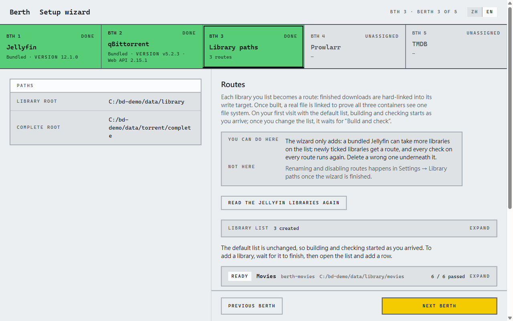
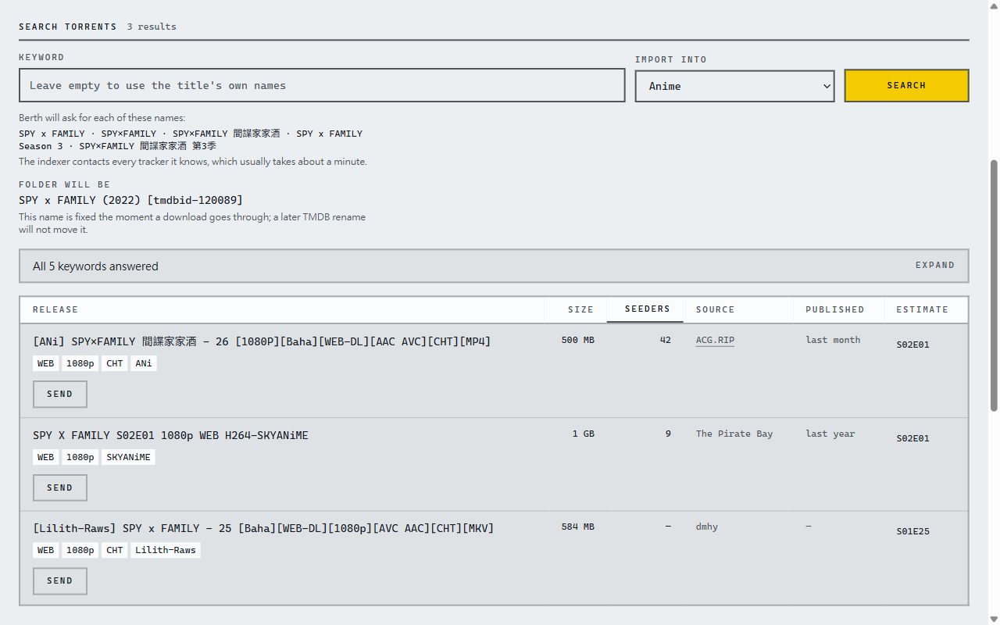
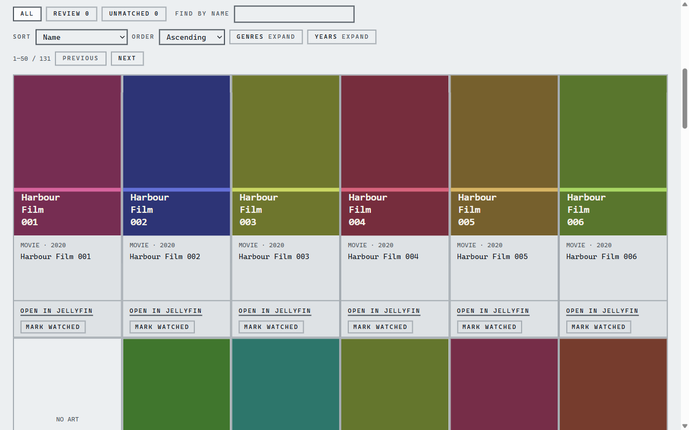
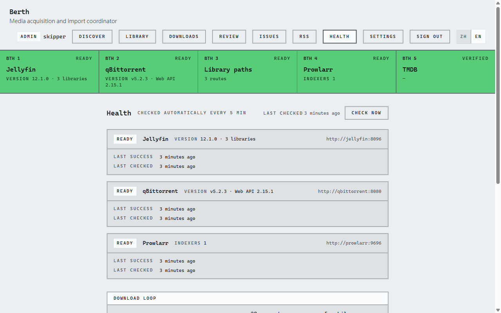

# Berth

[English](README.md) · **繁體中文**

自架的媒體取得工具，終點是你的 Jellyfin 媒體庫。

## 為什麼做 Berth

Seerr 搭配 Sonarr、Radarr 要設定好幾個服務，而且發佈由它替你挑，拿到的不一定是你要的版本。Berth 讓你自己挑
發佈，來源可以是 Prowlarr 的搜尋結果，或 RSS（例如追當季動畫用的 Mikan），再由 Berth 匯入 Jellyfin。

## 能做什麼

- 在作品頁搜尋 Prowlarr，發佈由你自己挑。
- 訂閱 Mikan、Nyaa、acg.rip 的 RSS：新的一集自動送出並入庫。
- 對照 TMDB 認出每個檔案是哪部電影、哪一集，以 Jellyfin 認得的名字硬鏈接進媒體庫，不佔兩份空間。
- 替放進去的每個檔案記帳；每晚的檢查找出被刪掉的集數、被複製檔取代的硬鏈接、
  沒人認領的 torrent，列出每一件能怎麼處理。
- 在健康頁每 5 分鐘重新檢查服務與媒體庫路徑。
- 用精靈帶你設定：設好套件內的 Jellyfin、qBittorrent、Prowlarr，或接你已經在跑的，
  並用一個真的檔案證明硬鏈接成立。
- 介面可用繁體中文或英文。

| | |
| --- | --- |
|  |  |
|  |  |

Berth 是公開 beta。依賴它之前先讀〈[現況](#現況)〉。

## 需要什麼

- Docker Engine 或 Docker Desktop，加 Compose 2.23.1 以上（`docker compose version`；`docker compose`，不是
  `docker-compose`）。
- 一個放下載與媒體的資料夾，在一顆支援硬鏈接的本機磁碟上：不是 exFAT、不是網路磁碟。
  細節見 [Requirements](docs/guide/requirements.md)（英文）。
- **一把免費的 TMDB API key，先申請**，約五分鐘：
  1. 在 <https://www.themoviedb.org/signup> 註冊並收驗證信。
  2. 開 <https://www.themoviedb.org/settings/api> 申請 API key，用途選 **Personal / Education**。
     即時核發。
  3. 留下 **API Key** 或 **API Read Access Token** 其中一個；兩種 Berth 都收。

## 安裝

1. 建一個放 Berth 的資料夾，放進兩個檔：[`docker-compose.yml`](https://github.com/1morr/Berth/releases/latest/download/docker-compose.yml)，以及存成 `.env` 的
   [`example.env`](https://github.com/1morr/Berth/releases/latest/download/example.env)。旁邊不用放別的東西。兩個連結下載的都是最新一版 Release 附的檔案，
   compose 才不會比 image 新。Unraid 改成把這兩份貼進 Compose Manager：見 [Unraid](docs/guide/requirements.md#unraid)（英文）。

   ```bash
   mkdir berth && cd berth
   curl -fsSLo docker-compose.yml https://github.com/1morr/Berth/releases/latest/download/docker-compose.yml
   curl -fsSLo .env https://github.com/1morr/Berth/releases/latest/download/example.env
   ```

2. 改 `.env`：
   - `DATA_ROOT`：下載與媒體庫放在哪；`CONFIG_ROOT`：四個服務的設定放在哪。預設的 `./data`、`./config` 試跑可以
     不改；正式用請給你媒體磁碟上的絕對路徑（`/srv/berth/data`、`C:\Berth\data`）。Unraid 上一定要是絕對路徑。
   - `PUID` / `PGID`：擁有 `DATA_ROOT` 的帳號（`id -u` / `id -g`；Unraid 是 `99` / `100`；
     [rootless Docker](docs/guide/requirements.md#rootless-docker) 是 `0` / `0`）。Windows 的 Docker Desktop 維持預設。
   - `TZ`：你的時區，例如 `Asia/Taipei`。
   - 已經在跑 Jellyfin、qBittorrent 或 Prowlarr？要接你原本那一台，就把它從 `COMPOSE_PROFILES` 拿掉；要兩台並存，
     就改它的 `*_PORT`。否則 `up -d` 會停在 `port is already allocated`。見
     [Connecting services you already run](docs/guide/existing-services.md)（英文）。

3. 啟動，等 `berth` 顯示 `(healthy)`（第一次拉 image 約一分鐘）。這台機器以前跑過 Berth 的話，`pull` 不能省：
   只 `up` 會起本機已有的舊 image。

   ```bash
   docker compose pull && docker compose up -d
   docker compose ps
   ```

4. 開 <http://localhost:8383>，照精靈走。

## 設定精靈

六頁。Jellyfin、qBittorrent、Prowlarr 三頁先選「**套件內**」（這份 compose 起的那一台）或「**既有**」（你自己
已經在跑的）；每個選擇 Berth 都當場測給你看。

1. **Jellyfin**：建立 Jellyfin 管理員，或以管理員登入。這個帳號也是你登入 Berth 的帳號。
2. **qBittorrent**：設它的介面登入，或填你原本那一台的位址與帳密。
3. **媒體庫路徑**：每個媒體庫各一條 *Route*（從下載到媒體庫的路），Berth 用一個真的檔案證明硬鏈接成立。
   套件內的 Jellyfin 預設建 Movies、TV、Anime；接你自己的，就勾選 Berth 可以寫進哪幾個媒體庫。
4. **Prowlarr**：按一次加入推薦的公開索引站，或用你自己的。可以先跳過；之後也可以在「設定 → Prowlarr」選不用它
   （RSS 訂閱照常運作）。
5. **TMDB**：貼上你的 key，要通過測試。
6. **完成**：說出跳過了什麼、去哪裡補。

逐頁細節，以及 Berth 在每個服務裡改了什麼：[Setup wizard](docs/guide/setup-wizard.md)（英文）。
備份 `${CONFIG_ROOT}/berth`（預設 `./config/berth`）：Berth 知道的一切都在那個資料夾。

## 現況

Berth 是**公開 beta**。

- 只支援 **Jellyfin 12.0 以上**與 **Prowlarr**。不支援 Emby、Plex、Jackett。
- 通知剛開始做：每個人都可以在一筆下載可以看了的時候收到 Discord 私訊，只收自己在 Jellyfin 看得到的媒體庫（設定 → 通知；bot 由管理員設一次）。管理員在那裡存了 Berth 的網址，私訊就帶作品頁的連結。管理員另外會在待審核、Issue 或待綁定的 RSS Series 有新的一件時收到「有 N 件等你處理」（等 10 分鐘收齊成一則），每週一還有一份週報：入庫了什麼、修了什麼、還有什麼等你處理（週報頁，附一則私訊摘要）。
- AI 剛開始做：設定 → AI 接上你自己的 provider（Anthropic 或 OpenAI 相容格式：Anthropic 與 OpenAI 官方、OpenRouter、DeepSeek、自架的 Ollama 或 vLLM 等），並測試它的模型能不能呼叫工具；設定 → 用量看每次呼叫花的 tokens 與快取命中率，不設預算。每一頁都有助理的側面板可以跟它說話，目前唯一的工具是查最近入庫。沒設定 AI 時 Berth 照常運作。見 [AI](docs/guide/setup-wizard.md#ai-settings--ai) 與 [助理](docs/guide/setup-wizard.md#the-assistant-side-panel)。
- 實測過 **Windows 的 Docker Desktop** 與 **Unraid 7.1**；Ubuntu 的 rootless Docker 測過一部分。其他系統還沒實測。
- **不要把 Berth 直接開到公網。** 從區網或 VPN 連。

## 指南

- [Setup wizard](docs/guide/setup-wizard.md)：逐頁細節、帳號與密碼、精靈之後的各頁。
- [Connecting services you already run](docs/guide/existing-services.md)：`/data` 掛載（Compose、
  `docker run`、Unraid 模板）、`COMPOSE_PROFILES`、換一台。
- [Requirements](docs/guide/requirements.md)：硬鏈接、Linux / Windows / Unraid、各服務的版本下限。
- [Upgrading](docs/guide/upgrading.md)：image tag、升級步驟、自己 build image。
- [Troubleshooting](docs/guide/troubleshooting.md)：port、`Unauthorized`、`host.docker.internal`。
- [Backup, secrets and reinstalling](docs/guide/backup-and-reinstall.md)：Berth 存了什麼、從頭再來、重建帳本。
- [Uninstalling Berth](docs/guide/uninstalling.md)：不用 Berth 時各服務要手動清什麼、硬鏈接怎麼釋放空間。
- [CHANGELOG](CHANGELOG.md)：每一版改了什麼。
- [開發](docs/development.md)：建置、測試與目錄結構。

## 授權與歸屬

MIT，見 [LICENSE](LICENSE)。


This product uses the TMDB API but is not endorsed or certified by TMDB.
（本產品使用 TMDB 的 API，但未經 TMDB 認可或認證。TMDB 的條款限非商業使用。）
