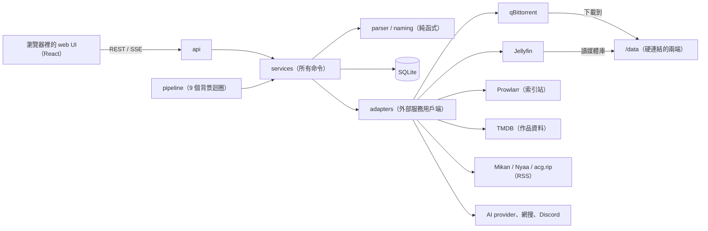
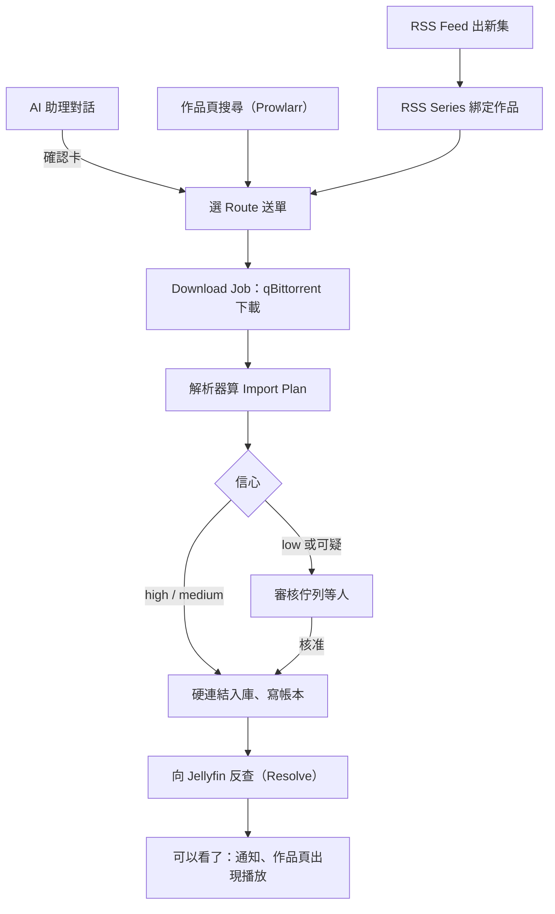

<!-- checkpoint: 1fd623f095b507a4a61c8eaf8cd07aed676e3925 M5.6 2026-11-12 -->

# Berth 導覽

給 repo 主人看的地圖：這個程式在做什麼、怎麼運作、改哪裡會動到什麼、哪些是你定的。細節和規則全文在 [design-brief](../design-brief.md)、[plan](../plan.md)、[ADR](../adr/)、[CONTEXT](../../CONTEXT.md)（名詞表）和程式碼裡；導覽和它們衝突時，以它們為準。由 `/1morr:checkpoint` 在里程碑之間更新。

## 一段話

Berth 是給自架 Jellyfin 的人用的「取片和入庫管家」。你在作品頁搜尋 torrent 自己挑，或訂閱 Mikan / Nyaa / acg.rip 的 RSS 追新番。Berth 把 torrent 交給 qBittorrent 下載，下載完判斷每個檔案是哪部作品、第幾季第幾集（特別會讀中文字幕組的命名），再用硬連結放進 Jellyfin 認得的資料夾和檔名，每一步都記帳，出錯能查、能修。側面板的 AI 助理可以代你操作，但沒有 AI 也完整可用。（`README.md`；brief §0）

## 核心原理

1. **硬連結入庫**：硬連結讓同一個檔案同時出現在下載資料夾和 Jellyfin 資料夾，卻只佔一份空間；qBittorrent 繼續做種，Jellyfin 播的是同一個檔。做不到（不同磁碟、exFAT）就擋下並說明，不偷偷改成複製。所以 Berth、qBittorrent、Jellyfin 必須共用同一個 `/data`。（`berth/adapters/fs.py`；brief §4.1、§4.4）
2. **Library Route**：一條「從下載到媒體庫的路」，綁定一個 Jellyfin 媒體庫、Berth 寫入的路徑和一個 qBittorrent category。送單時選 Route，Berth 就知道下載到哪、入庫到哪。畫面上叫「媒體庫」，程式裡叫 Route。（`berth/services/routes.py`；CONTEXT「Library Route」）
3. **Download Job 狀態機**：每個 torrent 是一筆 Job，沿著 `requested → submitted → downloading → completed → planning → importing → imported` 前進，中途可能停在 `review`（等人）或失敗狀態。每次轉換都用條件式更新，保證同一步不會做兩次；每一步寫一筆 Event，成為作品頁的時間線。（`berth/domain/enums.py`；plan §3.1）
4. **解析器和 Import Plan**：解析器是一串不連網的純函式：分類檔案 → 正規化字幕組寫法 → 解析季集 → 對到 TMDB 的季集 → 產出 Import Plan，每個檔案帶 high / medium / low **信心**。套用前不動任何檔案。high、medium 自動入庫（medium 會標「已入庫待確認」），low 停下等人。`berth bench` 用凍結的真實資料守住它：自動處置卻做錯的件數（`auto_wrong`）不能上升。（`berth/parser/`；plan §4）
5. **帳本、反查、對帳**：每個入庫的檔案寫一筆帳（Ledger Entry）。入庫後 Berth 反覆問 Jellyfin「這個檔案現在是哪個 item」（Resolve），找到才算「可以看了」。每天 04:00 比對帳本、qBittorrent、下載目錄、媒體庫四方，不一致就開 Issue 給人處理，從不自動刪。（`berth/services/resolver.py`、`reconcile.py`；brief §9）
6. **RSS Series**：RSS 訂閱的記憶單位是「一部作品 × 一個字幕組」，從 Feed 項目自動長出來，記住綁哪部作品、哪條 Route、季號偏移。全部接受、只排除；新 Series 的第一批要確認過才放行。（ADR [0007](../adr/0007-rss-series-model.md)；brief §15）
7. **AI 能做到哪裡，看能不能撤銷**：規則層（解析器）→ AI → 人，三層漏斗。可撤銷的命令 AI 驗證後自己做；不可撤銷的（刪檔、送出 torrent、改設定）一律做成確認卡（Proposal）等人按。每個命令在命令登錄表標了副作用和反向命令，這是唯一的判斷依據。（`berth/services/commands.py`；ADR [0008](../adr/0008-ai-autonomy-and-optional-ai.md)）

## 架構

瀏覽器只跟 api 說話；api 和背景迴圈都只呼叫 services，所有改狀態的事都是 services 裡的命令。services 用 parser 算 Plan、用 SQLite 存狀態、透過 adapters 打外部服務（測試時換成 Fake）。qBittorrent 和 Jellyfin 共用 `/data`，硬連結才做得成。整個 Berth 是一個容器、一個 Python 程序。依賴方向由 import-linter 強制（`pyproject.toml`；plan §1.3）。另外還有 Bangumi、AniList（新番時間表）和 mediainfo（讀片長）。

## 主要流程

送單有三個入口：作品頁自己挑、RSS 自動追、AI 助理提議（你按確認才送）。之後走同一條路：qBittorrent 下載，解析器算 Plan，有把握的直接入庫，沒把握的進審核佇列等你，入庫後等 Jellyfin 認出來才算「可以看了」。逐步細節見 [download-job](features/download-job.md)、[import-plan](features/import-plan.md)、[import-and-ledger](features/import-and-ledger.md)。

## 功能索引

| 功能 | 一句話 | 狀態 |
| --- | --- | --- |
| [設定精靈](features/setup-wizard.md) | 六頁接好 Jellyfin、qBittorrent、路徑、Prowlarr、TMDB，每個服務可選套件內或既有 | 已完成 |
| [Library Route](features/library-route.md) | 入庫目的地，建立和每次啟動都真的做一次硬連結驗證 | 已完成 |
| [登入與角色](features/login-and-roles.md) | 用 Jellyfin 帳號登入，Jellyfin 管理員就是 admin | 已完成 |
| [健康頁](features/health-check.md) | 每 5 分鐘檢查四項服務，泊位板紅綠燈 | 已完成 |
| [探索與作品詳情](features/discover-and-media.md) | TMDB 牆、季集表、缺哪集、為什麼沒入庫 | 已完成 |
| [作品搜尋與送單](features/search-and-send.md) | 用 Prowlarr 搜 torrent，分類驗證後給你挑 | 已完成 |
| [Download Job](features/download-job.md) | 一個 torrent 的一生：時間線、自動重送、刪除範圍 | 已完成 |
| [Import Plan 與解析器](features/import-plan.md) | 檔名 → 季集 → 目標路徑 → 信心 | 已完成 |
| [入庫、帳本與反查](features/import-and-ledger.md) | 硬連結入庫、記帳、等 Jellyfin 認出來 | 已完成 |
| [審核佇列](features/review-queue.md) | 沒把握的 Plan、待確認、對不到、重複版本一個清單 | 已完成 |
| [對帳與 Issue](features/reconciler-and-issues.md) | 每日四方對帳，異常開 Issue 給按鈕，不自動刪 | 已完成 |
| [巡檢與週報](features/sweep-and-weekly-report.md) | 每日查卡住、缺集、遲到，每週一份週報 | 已完成 |
| [時間表與追更](features/schedule-and-keeping-up.md) | 本週新番、訂閱的作品有沒有準時入庫 | 已完成 |
| [媒體庫頁](features/inventory.md) | 像 Jellyfin 那樣瀏覽，疊上入庫狀態和繼續看 | 已完成 |
| [通知](features/notifications.md) | Discord 私訊：可以看了、正在下載、有事等你 | 已完成 |
| [RSS Feed 與 RSS Series](features/rss-feed.md) | 追新番，自動長出 Series、補舊集 | 已完成 |
| [第一批確認](features/first-batch.md) | 新 Series 的第一批確認過才放行 | 已完成 |
| [AI 助理](features/assistant.md) | 側面板對話：查、搜、送單、訂閱、解釋 | 已完成 |
| [Proposal 與命令登錄表](features/proposal-and-registry.md) | 不可逆的動作做成確認卡，人按才執行 | 已完成 |
| [AI 用量與設定](features/ai-settings-and-usage.md) | provider 設定、用量、花費提醒、防護 | 已完成 |
| [AI 任務與人工接管開關](features/ai-task.md) | 規則層沒把握的事交給背景 AI，可逆的直接做 | M6 進行中，尚未實作 |

## 改這裡會動到什麼

依賴方向：`api | pipeline → services → adapters | models | parser → naming → domain`（`pyproject.toml` import-linter）。每次都要跑的是 `uv run pre-commit run --all-files` 加 pytest（`docs/development.md`〈全部檢查〉），下表只列另外要注意的。

| 模組 | 負責什麼 | 誰依賴它 | 另外要做的 |
| --- | --- | --- | --- |
| `berth/domain/` | 純資料型別與狀態機 | 幾乎全部 | 動到解析型別加跑 `berth bench` |
| `berth/parser/` | 分類、解析、季集對應、Plan、信心 | services | **`berth bench`，`auto_wrong` 不得上升** |
| `berth/naming/` | 命名模板、路徑清理 | parser、services | `berth bench`；Jellyfin 命名行為要重做 brief §20.1 的實測 |
| `berth/models/` | 資料庫表 | services、migrations | 產生 Alembic migration（`docs/development/commands.md`） |
| `berth/adapters/` | 外部服務用戶端，各有 Fake | services | 契約測試；改對外行為先查 brief §20 |
| `berth/services/` | 所有命令、命令登錄表、AI agent | api、pipeline | 公開 `async def` 要標 `@command`（`test_command_marks.py`） |
| `berth/pipeline/` | 背景迴圈何時醒、例外怎麼接 | main | 整合測試、真服務 e2e（`docs/development/e2e.md`） |
| `berth/api/` | HTTP 路由、門禁 | main | 改 schema 後跑 `pnpm -C web gen:api` |
| `berth/skills/` | AI 助理的三份決策順序 | services | `test_skills.py` 的行數上限 |
| `web/` | React 介面，中英並列 | — | typecheck / lint / test、`/impeccable`、playwright 實跑 |
| `deploy/` | compose 與部署檔 | 使用者 | 同輪改兩份 README 和 `docs/guide/` |

## 已知限制和脆弱處

- **環境限制**：只支援 Jellyfin 12 以上和 Prowlarr；Berth、qBittorrent、Jellyfin 要在同一台主機、共用 `/data`，不支援網路共享和 exFAT。（README〈Status〉；brief §4.4、§18）
- **以作品訂閱會挑錯季**：0.5.1 已經帶著這個 bug 發出去，會一次送出 39–100 筆舊集；M6 票 01 修，修完先發 0.5.2。（brief §20.29）
- **動漫季號**：TMDB 和字幕組的季號常不一致，是誤入庫的主要來源，靠偏移偵測、播出日比對、第一批確認緩解。（plan §12）
- **medium 信心自動入庫**：會提高誤入庫率，換來的是少等人；靠 benchmark 分開報 medium 的錯誤率、可一鍵撤銷。（brief §6.5）
- **SQLite 只有一個寫者**：寫交易裡不能打網路，否則 `database is locked`；`tests/integration/test_write_discipline.py` 守。（plan §3.3）
- **Jellyfin 認得慢**：入庫後約 12 分鐘才認得出，六次（約 42 分鐘）還認不出才開 Issue。（plan §3.2）
- **角色只在登入時更新**：在 Jellyfin 把人降權後，他已登入的 session 可能最長 30 天仍是 admin（推斷；`berth/services/auth.py` 的 `_mirror_user`）。見 [登入與角色](features/login-and-roles.md)。
- **健康檢查不重跑 qBittorrent 探針**：掛載事後壞掉時健康頁不會變紅，要手動「重新檢查」（`berth/services/routes.py` 的 `check_routes`）。
- **AI 防注入靠流程**：外部內容只當資料，確認卡參數由伺服器保存，按下時用存下的那份。（brief §14）
- 其他不排里程碑的已知問題：plan §11.9。

## 里程碑紀錄

M0–M5.5 只有 plan §11 的標題，細節在 `docs/archive/<里程碑>.md`；之後每次 checkpoint 補一句。

| 里程碑 | 驗收日 | 做了什麼 |
| --- | --- | --- |
| M0 | 2026-09-08 | 骨架 |
| M1 | 2026-09-17 | 手動全流程 |
| M1.5 | 2026-09-19 | 媒體庫瀏覽 |
| M2 | 2026-09-24 | 修正與對帳 |
| M3 | 2026-09-26 | RSS |
| M4 | 2026-10-23 | 巡檢與通知 |
| M5 | 2026-10-28 | AI 地基與對話 agent |
| M5.5 | 2026-11-04 | 新番與導覽 |
| M5.6 | 2026-11-08 | AI 對話精簡：一部作品選一次 Route、伺服器定 Route、skills 5→3、工具 22→18、以作品訂閱 |
