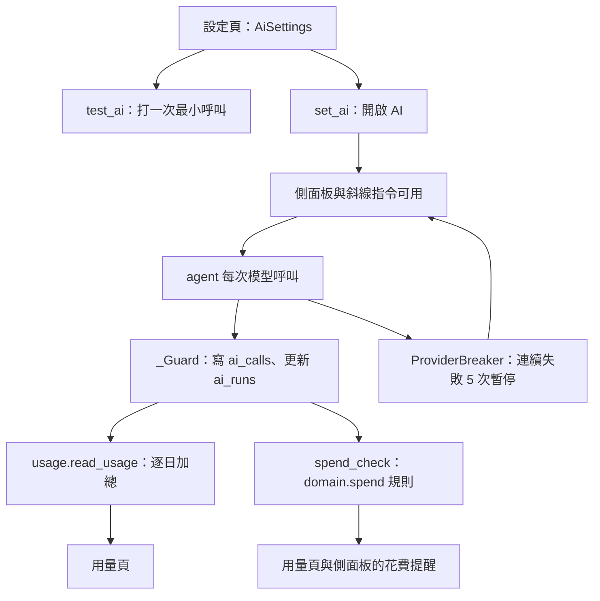

# AI 用量與設定（AI Settings / Usage）

## 用途

管理員在設定頁填 AI provider（Anthropic 或 OpenAI 相容）的網址、key、模型，按「測試連線」確認可用，再開啟 AI。開了之後，用量頁顯示近 30 天每天用了多少 token、快取、網搜、估計費用，以及防護擋下了幾次；可以設每日花費提醒值。**花費只提醒，不會停用 AI**。

## 怎麼運作

**設定**存在資料庫的 `settings.ai`（`AiSettings`，`berth/models/setting.py`），不讀環境變數。Anthropic 與 OpenAI 兩種接口各自記網址、key、模型，切換不會丟掉另一邊；`provider` 是現在用的，`enabled` 關著就是沒有 AI。

- **key 只進不出**：讀回去只有 `has_key`；服務錯誤訊息若貼回 key，先遮掉（`berth/services/ai.py`）。
- **key 只送給存它的端點**：測試連線、開關 AI 時，表單網址改了而 key 欄空著，就拒絕。否則改成別人的網址再按測試，會把存著的 key 送過去（`_key_for`）。
- **測試連線**打表單上還沒存的那份，只打一次最小呼叫；因為會連到任意網址又花 token，標 `CONNECTS_OUT`，所以 `needs_person` 為真。
- **模型欄建議**：沒按「取得模型」前只查本機價目表（`adapters/ai/prices.py`），不連外。

**用量**全部從三張觀測表算（`berth/services/usage.py`）：`ai_runs`（一輪）、`ai_calls`（每次模型呼叫）、`ai_tool_calls`（每次工具呼叫）。每次模型呼叫由 agent 的 `_Guard` 當場記帳，費用 = token × 價目表；查不到價目的記為「不知道」，**不當 0**。壓縮的摘要另記一列 `kind=compaction`，用量頁分得開。

**花費提醒**（`berth/domain/spend.py`）有兩種：今天到了設定的每日提醒值；或今天花費是近 14 天「有用量那幾天」日中位數的 5 倍以上（不到 3 天不比）。提醒只出現在用量頁與側面板，只給管理員，不推 Discord。有呼叫費用不知道時，畫面會明說幾次沒算進去。

**防護與斷路器**是用量頁的「防護」欄的來源：`ai_runs.stop_reason` 記每輪為何停下。provider 連續失敗 5 次，暫停 15 分鐘，側面板顯示到何時、為何（`ProviderBreaker`，`berth/services/agent_guards.py`）。

## 流程圖

管理員存好設定並開啟後，面板開始可用。每次模型呼叫都被 `_Guard` 記帳寫入觀測表，用量頁和花費提醒都從這些表即時算，沒有另外存一份。提醒值由 `set_spend_alert` 存回 `settings.ai`。呼叫連續失敗時斷路器暫停面板，過了時間自動恢復。

## 涉及的模組

- `berth/services/ai.py`（設定、測試連線、模型建議）、`berth/services/usage.py`（用量、提醒、單輪步驟頁）
- `berth/domain/spend.py`、`berth/adapters/ai/prices.py`、`adapters/ai/usage.py`
- `berth/models/ai.py`（`ai_runs`、`ai_calls`、`ai_tool_calls`）、`models/setting.py`
- `berth/api/ai.py`（`/settings/ai`）、`api/usage.py`（`/settings/usage`，管理員限定）
- 前端 `web/src/pages/AiSettingsPage.tsx`、`UsagePage.tsx`、`web/src/usage/`

## 相關決定

- [ADR-0016](../../adr/0016-ai-agent-architecture.md)：拿掉月預算上限，改成防護加只提醒的花費可見性；兩種 provider 都做。
- [brief §6.10](../../design-brief.md)：花費提醒的兩種規則與「未知不當 0」。
- 提醒基準「有用量的日子、至少 3 天」是使用者 2026-10-27 選定（`berth/domain/spend.py`）。

## 限制

- 費用是估計值，只用查得到價目的呼叫；自架閘道、DeepSeek 這類常常查不到。
- 斷路器狀態只在記憶體，Berth 重啟就清掉（`ProviderBreaker` 是程序內物件，推斷）。
- 一次送出的 torrent 上限 `card_downloads`（13）存在 `AiSettings`，但設定頁沒有這個欄位（`berth/models/setting.py` 的註解）。
- 沒有任何東西會因花費切斷 AI：若 key 被盜用或迴圈失控，只有防護上限與提醒，沒有硬上限。

## 細節在哪

`berth/services/usage.py` 與 `domain/spend.py` 的開頭 docstring；brief §6.10、§20.26（模型欄）；plan §8.8；名詞見 `CONTEXT.md`。對話本身見 [assistant.md](assistant.md)。
