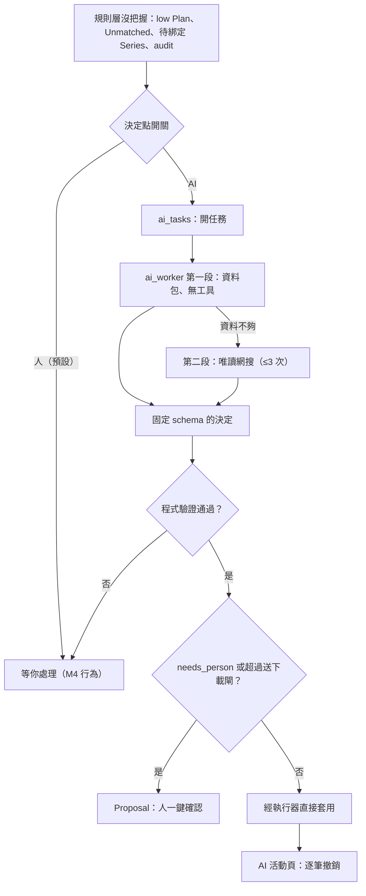

# AI 任務與人工接管開關（AI Task / AI Eval / AI Activity）

> **尚未實作，以下是 M6 定下的設計。** 12 張票全是 `ready-for-agent`，一張都還沒開工（`.scratch/m6/spec.md`〈票序〉）。程式裡沒有 `ai_tasks` 表、`ai_worker` 迴圈或 AI 活動頁。細節以 spec 為準，實作後會與這份不同。

## 用途

規則層沒把握的事，現在全部進「等你處理」讓人逐件按。M6 要讓 AI 在背景接手：可逆的通過驗證後直接做，不可逆的準備好 Proposal 給人一鍵確認，做不了的交回人。使用者可以在設定頁逐個**決定點**選「人」或「AI」，預設是人；關掉 AI 時行為與 M4 完全相同。

## 怎麼運作（設計）

**開關以決定點為單位，不以頁面為單位**，只有人 / AI 兩段，可隨時切回。決定點能不能切到 AI，要看它那一型任務的 AI 評估有沒有達標；沒達標的型別設定頁不提供選項。

**AI 任務**是 `ai_tasks` 表的一列，由事件觸發，一個任務一件事，`ai_worker` 迴圈處理。第一批有四型：

- 審核中的 Plan（規則層 low，加上播出日或片長檢查擋下的）
- Unmatched 檔案（指派到集或標 Extra）
- 待綁定的 RSS Series（猜作品、選 Route 後綁定）
- audit 與第一批（確認，或撤銷後 rematch；第一批證據夠就確認整批，季號或 offset 錯就改正一集寫回 Series）

**兩段呼叫**：

1. 第一段**不給工具**。程式先組好資料包（torrent 名、檔案清單與片長、規則層的部分解析、TMDB 季集結構、Bangumi / AniList / Mikan 資料），模型只能輸出固定 schema 的決定。這同時是成本防護與注入防護。
2. 模型若答「資料不夠」才有第二段：給唯讀網搜，網域白名單沿用對話 agent，最多 3 次。兩條網搜路都沒有就跳過、交給人。

**套用前一律驗證**：播出日比對、片長驗證、Jellyfin 回驗，再加集在 TMDB 存在、不撞目標路徑、季集範圍、副檔名與分類一致。不通過的不套用，交給人並附原因碼。套用一律經命令執行器，actor 用 AI 的身分，是否要人看 `needs_person`（不另開捷徑）。

**防護**：每次呼叫 2048 output、每輪 4 次模型呼叫、100K / 8K token、並發 2、同一對象 24 小時最多試 2 次，「交給人」的結論也快取；provider 斷路器沿用對話那套。

**送下載的閘**：背景任務叫帶 `Flag.DOWNLOADS` 的命令時，這次會送出的 torrent 超過 `AiSettings.card_downloads`（13），或送完磁碟低於最低剩餘設定，就改成 Proposal。

**AI 評估**取代原本的影子模式（使用者不逐件處理，量不出一致率）：每型一份凍在 repo、附標準答案的案例集，手動跑真模型。只動可撤銷東西的至少 20 件，會送下載的至少 60 件。門檻是**套用而錯的 0 件，交回人的比例 < 5%**（2026-11-12 使用者定）。

**可見與可撤銷**：AI 活動頁列出做了什麼、理由、花費，逐筆撤銷（反向命令照登錄表）；審核頁每件附 AI 的理由；週報列 AI 這週處理與交回的件數。

## 流程圖

規則層沒把握的事，先看那個決定點的開關。開關在人就走原本的「等你處理」；在 AI 才開任務。`ai_worker` 先不給工具組資料包問模型，需要時才補一次網搜，得到固定格式的決定。決定要過程式驗證，不過就交回人；過了之後，不可逆、或會送太多 torrent 的做成 Proposal，其餘直接套用並記在 AI 活動頁。

## 涉及的模組（預定）

- 新增：`ai_tasks` 表（migration）、`ai_worker` 迴圈（`berth/pipeline/`）、各任務型別的資料包與 schema（`berth/services/`）、AI 活動頁與設定頁開關。
- 沿用：命令登錄表與執行器、Proposal、`adapters/ai/fake.py`（整合測試不打真模型）、`ai_runs` / `ai_calls`、`services/web.py` 的網搜白名單。
- 評估腳本與結果：`scripts/experiments/`、`.local/experiments/results/`、`docs/research/`。

## 相關決定

- [ADR-0008](../../adr/0008-ai-autonomy-and-optional-ai.md)：可逆的 AI 自己做，不可逆的永遠要人；信任靠 AI 評估，不靠影子模式。
- [ADR-0016](../../adr/0016-ai-agent-architecture.md)：內建 agent、不設月預算上限；卡住的三種 Job 開 Issue。
- [brief §6.10、§14](../../design-brief.md)：AI 的角色、輸入輸出、評估門檻與 13 個 torrent 的閘（2026-11-11）。
- 範圍外：Issue 各型別、每週巡檢交給 AI、修正回流，移到 M6.5（plan §11.7b）。

## 限制（設計上已知）

- 送下載的閘靠數量上限擋，不靠評估，因為送錯的 torrent 收不回。
- 評估件數有統計下限：全對時 20 件只排除得了錯誤率高於約 14%，60 件約 5%（spec〈AI 評估〉）。
- 開 M6 前要先修 M5.6 遺留：以作品訂閱挑錯季（發 0.5.2）、確認卡列結構、卡住的三種 Job 開 Issue。

## 細節在哪

`.scratch/m6/spec.md`（目標、範圍、共同規則、驗收、票序）與 `.scratch/m6/issues/05`–`10`；brief §6.10、§14；plan §4.5、§11.7；`docs/research/m5-ai-direction-2026-10-27.md` 的 C1 表（逐點接管邏輯）。
