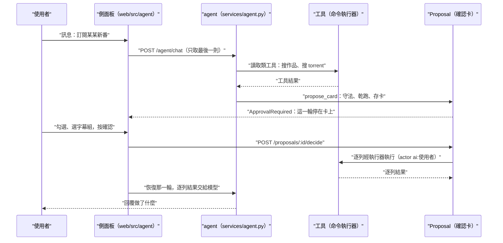

# AI 助理（Assistant / Conversation / Skill / Slash Command / Compaction）

## 用途

每一頁都叫得出的側面板對話。使用者說「下載 Re:Zero 全系列」「訂閱這部新番」「為什麼這集沒入庫」，助理查資料、搜 torrent，把要做的事整理成確認卡，人按了才執行。一般使用者也能用，但只看得到讀取類工具與自己的送單（ADR-0016）。AI 設定關著時整個面板不存在，Berth 其餘功能與沒有 AI 時相同。

## 怎麼運作

**助理沒有任何自己的捷徑：它只能呼叫命令登錄表裡被挑出來的命令，而且一律經命令執行器。** 這是 AI 不能在沒人確認下做不可逆動作的根本原因。

- **一輪（Turn）**：一則使用者訊息到模型答完。用 pydantic-ai 跑，歷史由伺服器存在 `ai_conversations`，前端送來的歷史、工具結果、核准一律不採用，只取最後一則使用者的字（`berth/api/agent.py` 的 `chat`、`berth/services/agent.py` 的 `open_turn`）。一輪不綁連線，斷線照跑完，誰來看都從頭重播。
- **工具**：`agent_tools.TOOLS` 共 18 個（我實際數過），其中 `web.tavily_search` 只在設了 Tavily key 時給，所以一般是 17 個。誰看得到哪些，照命令的 `audience`（`visible_tools`）。寫入類全部出確認卡：`needs_card` 的條件是命令 `needs_person`，或帶 `Flag.DOWNLOADS`（送 torrent）。
- **確認卡**：模型呼叫寫入工具時不會執行，而是 `propose_card`：逐列守法（`agent_origins`：id 必須出自這段對話先前的工具結果；網址必須逐字出自使用者打的字；出自外部內容的自由文字在卡上標警示）、乾跑驗證、`proposals.propose` 存卡，然後丟 `ApprovalRequired` 讓這一輪停在卡上。**Route 由伺服器定**（M5.6）：模型不給 Route，零條拒絕、一條直接用、多條由人在卡上選；訂閱的字幕組也由人選。詳見 [proposal-and-registry.md](proposal-and-registry.md)。
- **skills**：剩 3 份（`berth/skills/` 的 `download`、`subscribe`、`recommend`），只寫決策順序，用 `skills.load_skill` 才載入全文，instructions 只列名稱與描述。三份合計 ≤ 80 行，由 `tests/unit/test_skills.py` 守。
- **防護**（`Limits`）：每輪最多 20 次模型呼叫、400K input / 30K output token、同工具同參數第 2 次警告、第 3 次擋、第 4 次中止；每輪最多 5 次網搜；每人同時 1 輪；provider 連續失敗 5 次暫停 15 分鐘（`ProviderBreaker`）。每次模型呼叫記一列 `ai_calls`。
- **壓縮**：一輪開頭若上次回應已佔 context window 的 60%，把舊歷史換成摘要，保留最後 2 輪（`berth/services/compaction.py`）。
- **斜線指令**：`/new`、`/compact`、`/usage`。整則訊息就是 `/名字` 才算，不經過模型，只有 `/compact` 的摘要會花一次呼叫（`berth/services/slash.py`）。

## 流程圖

使用者說了一句話，面板只送最後一則給伺服器。agent 用讀取類工具查資料，要寫入時改出確認卡並讓這一輪停住。使用者按確認後，伺服器當場經執行器執行存下的那份參數，不信前端回傳的；恢復的那一輪只把逐列結果交給模型，由它向使用者回報。

## 涉及的模組

- `berth/services/agent.py`（2118 行：一輪、確認卡、記帳）、`agent_tools.py`、`agent_origins.py`、`agent_guards.py`、`agent_live.py`
- `berth/services/skills.py`、`compaction.py`、`slash.py`、`web.py`（網搜）、`anilist.py`、`bgm.py`
- `berth/api/agent.py`；`berth/adapters/ai/`（Anthropic 與 OpenAI 相容）、`adapters/websearch/`
- 前端 `web/src/agent/`（3642 行）；skills 在 `berth/skills/`

## 相關決定

- [ADR-0016](../../adr/0016-ai-agent-architecture.md)：內建 agent 加之後匯出的 MCP，用 pydantic-ai，不設月預算上限，兩種 provider 都做。
- [ADR-0008](../../adr/0008-ai-autonomy-and-optional-ai.md)：可撤銷的 AI 自己做，不可撤銷的永遠要人，沒有 AI 也完整可用。
- [brief §14](../../design-brief.md)：哪些動作一律出確認卡、Route 與字幕組由誰選、skills 只寫決策順序。

## 限制

- 目前對話裡**沒有任何直接寫入**：連可逆的關鍵字訂閱也出卡（`berth/services/agent.py` 的 `_toolset` 以 assert 守著）。
- 注入防護靠流程不靠模型聽話：外部內容（網搜、AniList、Bangumi）是資料，id 與網址有來源檢查。
- 不依賴 `pydantic-ai-harness` 的壓縮，自己實作（`compaction.py` 說明原因：切點與孤兒 result）。
- 「S2 系列只要列清單也先搜 20 次種子」是 M5.6 遺留，由 M6 票 02 處理。

## 細節在哪

`berth/services/agent.py` 開頭 docstring；brief §14、§20.24（串流協定、壓縮）、§20.26；plan §11.6、§8.8–8.10；名詞見 `CONTEXT.md` 的 Assistant、Turn、Skill。
