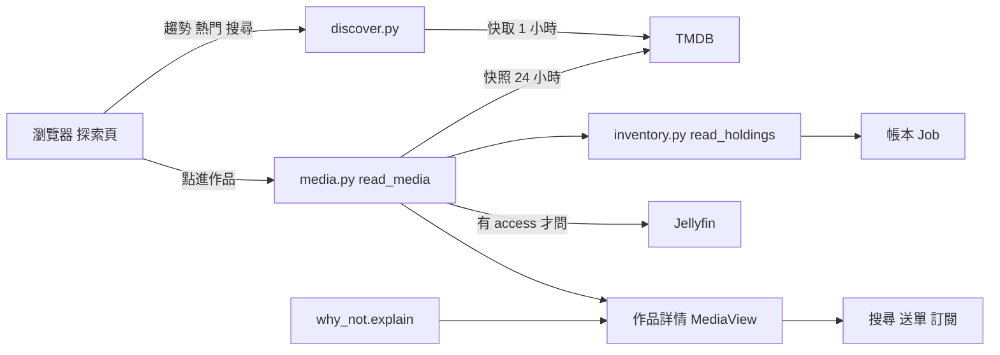

# 探索與作品詳情（Media、Why Not）

## 用途

探索頁（`/`）是一面 TMDB 海報牆：本週趨勢、熱門，加一個搜尋框。點進一張卡就是作品詳情（`/media/:id`），它同時是「決策中心」：看季集表哪些已入庫、哪些缺、為什麼沒入庫，從這裡搜 torrent、送單、訂閱 RSS，已在 Jellyfin 的作品最上面還有觀看區（`brief §13`）。探索牆與媒體庫牆是兩件事，後者見 [媒體庫頁](inventory.md)。

## 怎麼運作

**Media 是 TMDB 上的一部作品，鍵是 `tv:<tmdb id>` 或 `movie:<tmdb id>`。** Berth 只有 TMDB 一個 metadata provider。探索牆的卡片快取 1 小時，每個 feed 一列，快取存的是合併好的卡片，不是 TMDB 原始回應（`berth/services/discover.py:41`）。

**同一部作品要問 TMDB 兩輪語言，後端卻不知道 UI 語言。** 英文那一輪（`en-US`）是清單本身，也決定檔名；`zh-TW` 那一輪只是查表，補顯示用標題和海報。兩輪都送給前端，前端依介面語言挑一個，換語言不重抓。方向不能反過來：用 `zh-TW` 當清單，TMDB 會換掉成員與順序，作品會憑空消失（`berth/services/discover.py:1`、`CONTEXT.md` Display Round）。

**詳情頁的季集表來自 Media 快照，24 小時一次。** `read_media` 發現快照過期就順手重抓：英文、`zh-TW`、`zh-CN` 三輪詳情加每季一次，`zh-CN` 只為了季名（字幕組寫「柱训练篇」，TMDB 兩種語言都不同字）。規劃前若快照超過 6 小時再刷新，因為新播的那一集正是使用者在下載的那一集（`berth/services/media.py:70`、`327`）。重抓失敗不丟例外，回舊快照加一句「這是舊的」。

**「已追蹤」是推導出來的，不是欄位。** 只要這部作品有 Job，就算 Tracked Media；探索牆一次問一整面牆，不逐格查（`berth/services/tracking.py`）。

**每一集的狀態與「為什麼沒入庫」是兩層。** 季表上一集的狀態按優先序：已入庫、卡住、下載中、Jellyfin 已有、缺、未播出（`EpisodeStatus`）。「Jellyfin 已有」指這位使用者看得到的 Jellyfin 有、帳本沒有，不算缺，缺集搜尋也不問它。Why Not 則是十種結論分類（入庫失敗、沒下載成、等審核、待綁定、被排除、沒有來源、還在下載、Jellyfin 還沒掃到、還沒播、已入庫），宣告順序即優先序，規則只在 `berth/domain/why_not.py` 一份，畫面與 AI 助理都讀同一個結果（`berth/services/why_not.py:293`）。

使用者在探索頁看到的卡片來自 `discover.py`，向 TMDB 取回後快取一小時。點進作品後 `read_media` 取 TMDB 快照，並由 `inventory.read_holdings` 對照帳本與 Job 算出每集狀態；有 Jellyfin 權限時再問 Jellyfin 作品在不在。這份 `MediaView` 加上 Why Not 結論就是詳情頁，下方接[作品搜尋與送單](search-and-send.md)。

## 涉及的模組

- `berth/services/discover.py`、`tracking.py`：探索牆與已追蹤推導。
- `berth/services/media.py`：快照、資料夾名、可選 Route（`folder_name` 在第一次送單成功時凍結）。
- `berth/services/inventory.py`（`read_holdings`）、`why_not.py`、`berth/domain/why_not.py`。
- `berth/adapters/tmdb/`；前端 `web/src/discover/`、`web/src/media/`。

## 相關決定

- [ADR-0004](../../adr/0004-library-browsing-and-discovery.md)：探索頁只放 TMDB 牆，繼續觀看與下一集只在媒體庫頁。
- [ADR-0005](../../adr/0005-display-title-follows-ui-language.md)：顯示用標題與海報跟 UI 語言走，檔名永遠用英文。
- [設計簡報 §13](../../design-brief.md)：頁面清單與詳情頁各塊的規則。
- [plan §8.3](../../plan.md)：TMDB 快取壽命與請求數。

## 限制

- TMDB 是唯一來源，key 由使用者自備；沒有 key 或被擋，探索與詳情頁只顯示原因（`TmdbProblem`），不會空白。
- 打的字整串當片名，「Nosferatu 1922」查不到（`search/multi` 不吃年份，`berth/services/discover.py:144`）。
- 探索卡片目前只有「追蹤中」一個標記。`brief §13` 寫四種狀態（未追蹤、部分、完整、下載中），但 `discover.py:8`、`discover.py:297` 與 `web/src/discover/MediaTile.tsx:51` 都只做了 `tracked`。

## 細節在哪

`plan §8.3`、`§6`（discover、media 端點群）；`brief §7.5`、`§13`、`§20.3`；`CONTEXT.md`〈Media〉〈Display Round〉〈Jellyfin Holding〉〈Why Not〉。
