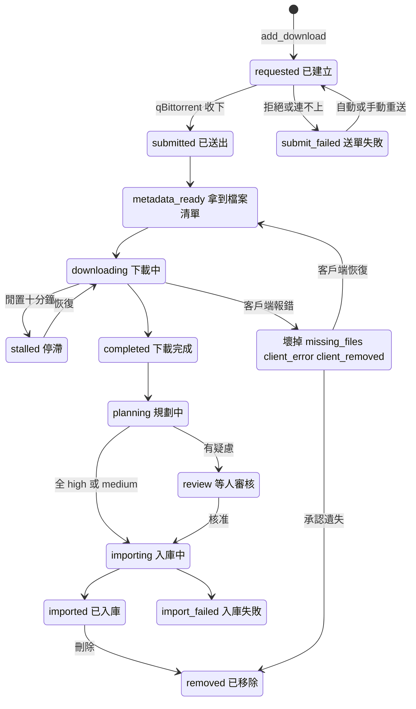

# Download Job（Download Job、Delete Scope）

## 用途

Download Job（簡稱 Job）是一個 torrent 在 Berth 裡的生命週期紀錄，以 info hash 為鍵。使用者在「下載」頁看到全部 Job 的狀態與進度，點進 `/jobs/:hash` 看時間線（Event）、檔案清單，並能重試、重新規劃、重新入庫或刪除（`brief §13`）。刪除時可勾四個旗標，叫 Delete Scope。

## 怎麼運作

**Job 是一台狀態機，只有一個人能同時改它。** 送單（`add_download`）先把 Job 寫成 `requested` 並 commit，之後才打 qBittorrent；這樣打到一半當機，也不會留下一個 Berth 不認得的孤兒 torrent（`berth/services/jobs.py:377`）。送單前先查 Route 與磁碟門檻，門檻會把「已送出但還沒下完」的位元組一起扣，免得一次送一百多個把磁碟灌滿（`berth/services/jobs.py:1052`、`1101`）。

**qBittorrent 沒有 webhook，所以 Berth 用輪詢推進狀態。** `qbit_poller` 有活躍 Job 時每 5 秒、閒置時每 30 秒問一次 `sync/maindata`，失敗退避到 5 分鐘（`berth/services/downloads.py:75`）。每個轉換都是 compare-and-set：`UPDATE ... WHERE state = 舊狀態`，影響 0 列就放棄，因為使用者的第二個分頁或別的迴圈可能剛改過同一列（`berth/services/jobs.py:1308`、`plan §3.1`）。壞掉優先：`missingFiles` 的 torrent 也可能回報 100%，所以先判壞再判完成。

**送單失敗分「暫時」和「等人」。** 連不上、逾時、429、5xx 是暫時的，poller 在問得到 qBittorrent 的那一輪自動重送，間隔 1 分、10 分、1 小時、6 小時，用完才停下等人；一輪遇到第一筆又失敗就收手（`berth/services/jobs.py:569`）。404、415 這類再問也一樣的，直接等人。

**停滯看 qBittorrent 自己量的閒置時間**，超過 10 分鐘 `downloading` 轉 `stalled`，恢復動作就轉回（`berth/services/downloads.py:87`）。下載完成之後的 `planning`、`review`、`importing` 由規劃器與 importer 推進，見 [Import Plan 與解析器](import-plan.md)。

箭頭從 `[*]` 起：送單建出 `requested`，qBittorrent 收下就是 `submitted`，收不下進 `submit_failed` 再回 `requested`。之後依客戶端回報走 `metadata_ready`、`downloading`，途中可能停滯或壞掉，壞掉的在客戶端恢復後回 `metadata_ready`。下載完成經 `planning` 走向 `importing` 或 `review`，成功是 `imported`。圖為了可讀省略了多條邊：任何狀態都能被 `delete_job` 轉成 `removed`，`imported` 等狀態也能重新入庫回 `completed`（完整表見 `plan §3.1`）。

## Delete Scope

**刪除是四個可勾的旗標，預設全不勾**：移除媒體庫硬連結（`unlink`）、從 qBittorrent 移除 torrent（`remove_torrent`）、刪下載目錄裡的檔案（`delete_files`）、清除帳本與 Job 紀錄（`purge`）。預設不勾是因為刪除以 Job 為單位，預設刪檔會誤刪還在做種的東西（`berth/services/deletion.py:62`）。

- 順序固定為移除 torrent、移除連結、刪來源、清紀錄。移除 torrent 排第一，因為它是唯一可能失敗的一步，失敗就整次不做。
- `delete_files` 必須同時勾 `remove_torrent`，否則 qBittorrent 重新檢查時會把整包再抓一遍。
- 空間估算逐一 `stat`，按 `(device, inode)` 分組，只有某個檔案的所有名字都刪掉才算「真的釋放」（`berth/services/deletion.py:120`）。
- 媒體庫那一側只拆 Berth 放的連結：inode 對不上帳本也對不上來源，就當作使用者自己的檔案，列在 `unmanaged` 不刪（`Placed`，`berth/services/deletion.py:376`）。
- 兩個分頁同時刪，後到的得到 409 `moved_on`。沒勾 `purge` 的 `removed` Job 留著，同一個 torrent 再送單會被拒（`job_removed`）。

## 涉及的模組

- `berth/services/jobs.py`：送單、重試、自動重送、轉換與事件、`job_lock`。
- `berth/services/downloads.py`、`berth/pipeline/downloads.py`：輪詢與客戶端驅動的轉換。
- `berth/services/deletion.py`：Delete Scope。
- `berth/adapters/qbittorrent/`；前端 `web/src/jobs/`。

## 相關決定

- [設計簡報 §5、§9.2](../../design-brief.md)：狀態機、時間線、刪除範圍四旗標預設全不勾。
- [plan §3.1](../../plan.md)：轉換表為準，轉換一律 compare-and-set。
- [ADR-0016](../../adr/0016-ai-agent-architecture.md)：重試用完的 `submit_failed`、`import_failed`、停滯目前沒有 Issue，已決定要開（M6 票 04，推斷尚未實作）。

## 限制

- 輪詢是唯一的驅動，qBittorrent 沒有 webhook；Berth 停機期間的變化在下一輪才補上。
- 迴圈與 API 共用一把 SQLite 寫鎖，網路呼叫不能放在寫交易裡（`plan §3.3`）。

## 細節在哪

`plan §3.1`（轉換表）、`§3.3`（冪等與重入）、`§8.1`（qBittorrent adapter）；`brief §5`、`§9.2`、`§20.2`。
