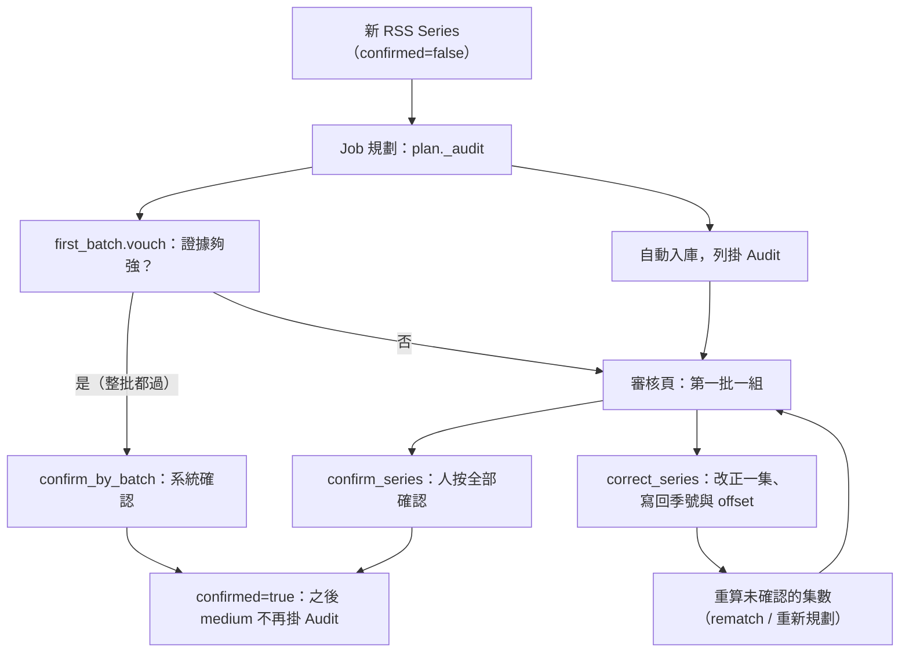

# 第一批確認（First batch）

## 用途

新追的番組，前面幾集若季號或 offset 算錯，會整季一起錯。所以一個新 RSS Series 在被確認之前，送進來的每一集入庫後都掛 Audit（在審核頁顯示「已入庫待確認」）。使用者在審核頁看到以 RSS Series 分組的一組，可以「全部確認」，或改正一集並套用到整個 Series。證據夠強時系統自己確認，使用者什麼都不用做。

## 怎麼運作

**核心旗標是 `RssSeries.confirmed`。** 它是 `false` 時，規劃器給這個 Series 的自動入庫列一律掛 Audit，連 high 信心也掛（`berth/services/plan.py` 的 `_audit`）；確認之後 medium 也不掛，改由播出日比對、片長驗證與 Jellyfin 回驗守著。「第一批」就是 Series 到確認為止送來的所有集數。

離開第一批有三條路：

1. **系統擔保**（`first_batch.vouch` → `confirm_by_batch`）：規劃器每算出一份自動入庫的計劃就問一次。純函式 `vouch_first_batch`（`berth/parser/first_batch.py`）逐列檢查，一列不符整批就不算：
   - Series 沒設季號與 offset。
   - 只有正片與跟著的字幕。
   - 季集照檔名字面（或季號寫明的累計編號），理由只能在白名單內。
   - 播出日比對拿得到日期且通過，那一集剛播。
   - 同 Series 的其他 Job 都已落地（`importing` 或 `imported`），它們掛著的 Audit 也都擔保得了。

   全過就標 `confirmed`、清掉那些 Audit，每個 Job 的時間線記 `series_confirmed`。補舊集一次送十幾筆時，前面幾筆先掛著，最後一筆落地才整批一起看。
2. **人按「全部確認」**（`series_review.confirm_series`）：逐列確認畫面上那幾列，再標 `confirmed`。
3. **人改正**（`correct_series`、`correct_series_from_plan`）：由人改的那一集算出 offset，寫回 Series，再重算它底下還沒確認的集數。已入庫的走 rematch 搬到正確的集，停在 review 的走重新規劃。重算的集數仍留在第一批裡等「全部確認」，人親手改的那集視為確認過。

審核頁與作品頁的「第一批待確認」說的那句話，來自 `first_batch.asks`：蓋到哪幾集、季集怎麼讀出來的。

## 流程圖

新 Series 的第一份計劃自動入庫時，先問 `vouch`：證據夠強就直接確認，列不掛 Audit；否則照舊掛 Audit，出現在審核頁。人可以全部確認，或改正一集，改正會把季號與 offset 寫回 Series 並重算同批其他集，仍回到審核頁等確認。任何一條路確認後，Series 之後的入庫照一般信心走。

## 涉及的模組

- `berth/services/first_batch.py`（擔保與「在問什麼」）、`berth/services/series_review.py`（確認與改正）
- `berth/parser/first_batch.py`（擔保條件，純函式）、`berth/services/plan.py`（`_audit`）
- `berth/services/rematch.py`（搬家的實作）、`berth/models/rss.py`（`confirmed`、`season`、`episode_offset`）
- 前端：`web/src/review/`、`web/src/pages/ReviewPage.tsx`

## 相關決定

- [brief §15〈季號、offset 與第一批確認〉](../../design-brief.md)：第一批進審核，證據夠強的由系統確認。「確認後 medium 不再掛 Audit」是使用者 2026-09-24 拍板（`berth/services/plan.py` 的 `_audit` docstring）。
- [ADR-0007](../../adr/0007-rss-series-model.md)：RSS Series 是記憶單位，季號與 offset 存在它身上。

## 限制

- **已知盲點**：前一季只有幾集、緊接著開播 TMDB 還沒建的新一季時，新一季第 1 集可能被當成舊的第 1 集，系統就確認了錯的 Series，之後靠播出日比對與「TMDB 沒有這集」接住（`berth/parser/first_batch.py` docstring）。
- 確認沒有反向命令；確認錯了只能靠後面的程式檢查發現（`series_review.confirm_series` docstring）。
- Jellyfin 回驗抓不到集數算錯，因為 Jellyfin 認集數靠 Berth 取的檔名（brief §6.10）。
- 擔保要等同 Series 的其他 Job 都落地，下載慢或停在 review 的一集會讓整批一直待確認。

## 細節在哪

`berth/parser/first_batch.py` 的 docstring 有七條擔保條件的全文與理由；`berth/services/series_review.py` 的 docstring 有搬家順序（offset 小於這批集數時要先問目標格上是誰）；brief §15；名詞見 `CONTEXT.md` 的「第一批」「Audit」。RSS 的整體見 [rss-feed.md](rss-feed.md)。
