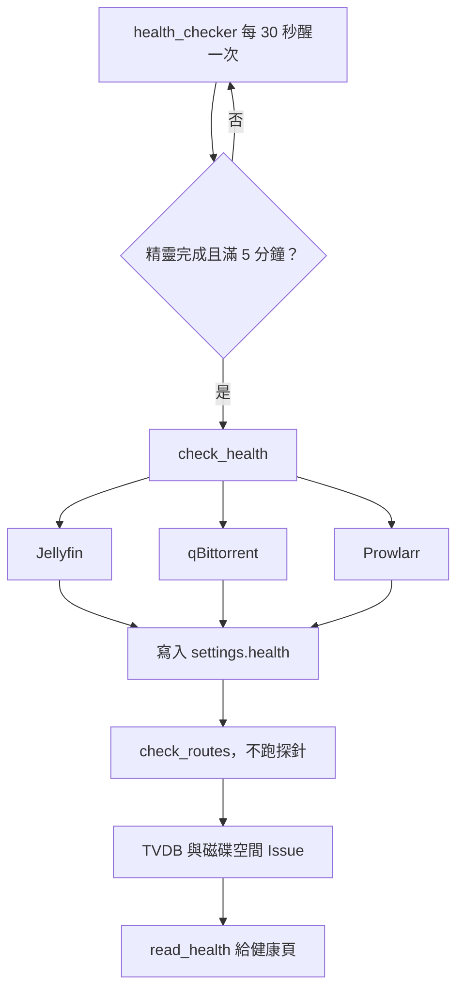

# 健康頁（Health Check）

## 用途

健康頁告訴你 Berth 現在還能不能做完一次入庫：Jellyfin、qBittorrent、索引站（Prowlarr）、Route 四項各是紅是綠，並顯示上次檢查時間。頁上有「立即重測」。TMDB 那格不是檢查，只是讀精靈當時測 TMDB 憑證的結果。畫面是「泊位板」，和精靈、設定頁同一個順序（`CONTEXT.md`「Health Check」）。

## 怎麼運作

**每 5 分鐘一輪。** 背景迴圈 `health_checker` 每 30 秒醒一次，只有上一輪已滿 5 分鐘才真的檢查（`is_due`）。醒得比檢查勤，是為了精靈剛跑完時不用對著空的健康頁等 5 分鐘。精靈沒跑完不檢查，因為那時被接的服務打了只會得到假紅燈（`berth/pipeline/health.py`、`CHECK_INTERVAL`）。

**四項各自獨立。** 每一項的例外在自己那格接住，一個服務掛掉只讓它自己變紅（`health.py` 的 `_run`）：

- Jellyfin：版本 ≥ 12.0，而且 Berth 的 API key 列得出媒體庫。只看連得上不夠，key 被撤銷時匿名的 `public_info` 照樣是綠的。
- qBittorrent：連得上、Web API 夠新；被 IP 封鎖有自己的旗標，因為改帳密沒用。
- 索引站：Prowlarr 搜得動。你在精靈選「之後再說」或在設定頁「不用 Prowlarr」，就是 `unknown`，不算阻擋。
- Route：重跑每條 Route 的六條檢查，見 [Library Route](library-route.md)。總結不存，每次從 `routes` 表算，所以精靈、重新檢查、換 qBittorrent 之後立刻一致（`routes_health`）。

**紅、綠、未知。** 「降級」（`degraded`）只在有一項已知壞了才成立；`unknown`（還沒檢查、沒設定）不算。匿名的 `GET /api/health` 只回 `ok` 或 `degraded`、版本和精靈跑完沒，給 compose 的 healthcheck 用，而且只讀紀錄，不去連任何服務（`overall_status`）。

**量出兩種 Issue。** 四項之後再量兩件要人決定的事：Route 的媒體庫掛了 TVDB metadata、磁碟剩餘空間低於門檻。它們不是紅燈，服務都還連得上，所以開成 Issue（`library_uses_tvdb`、`low_disk_space`）。條件解除時系統自己收掉；問不到 Jellyfin 或量不到目錄不算解除（`health_issues.py`）。見 [對帳與 Issue](reconciler-and-issues.md)。

迴圈醒來先看精靈完成沒、上一輪過了 5 分鐘沒，才呼叫 `check_health`。三個服務各自檢查、結果寫進 `settings.health`，接著重跑 Route 檢查，最後量 TVDB 與磁碟空間兩種 Issue。健康頁讀的是這些紀錄，「立即重測」按的是同一支命令。

## 涉及的模組

- `berth/pipeline/health.py`：迴圈與排程。
- `berth/services/health.py`：四項檢查、紀錄、`read_health`、`overall_status`。
- `berth/services/health_issues.py`：TVDB 與磁碟空間兩種 Issue。
- `berth/services/routes.py`：Route 那一項（`check_routes`、`routes_health`）。
- 前端：`web/src/health/`、`web/src/pages/HealthPage.tsx`。

## 相關決定

- [ADR-0002](../../adr/0002-jellyfin-12-minimum-pinned-image.md)：只支援 Jellyfin 12 以上，低於 12 時精靈和健康檢查紅燈並說出升級注意。
- [ADR-0013](../../adr/0013-berth-manages-only-its-own-objects.md)：qBittorrent 全域偏好不看也不寫，檢查只問 Berth 自己的東西。
- [設計簡報 §9.1](../../design-brief.md)：`library_uses_tvdb`、`low_disk_space` 兩種 Issue 的判定與「忽略在條件持續期間有效」。
- `plan §3.2`：沒有逐服務退避，每項各自 try/except 加 5 秒逾時就夠隔離。

## 限制

- 5 分鐘的迴圈不跑 qBittorrent 的探針 torrent，因為它會觸發使用者的「完成時執行外部程式」；`download_visible` 沿用上次結果，要「重新檢查」才真的問（`health.py` 的 `_check_routes`）。
- 迴圈裡的例外只記 log、不讓迴圈死；但這代表某一輪壞了你只會看到「上次檢查」時間落後（`pipeline/health.py` 檔頭）。
- 連不上 Prowlarr 時，每 30–60 秒只重測它一台，其餘照 5 分鐘（`RECHECK_INTERVAL`）。
- 預設磁碟門檻是 10 GB，可在設定改（brief §9.1）。

## 細節在哪

`plan §3.2`〈health_checker〉、`plan §9.5`、`design-brief.md` §16.2、`berth/services/health.py` 檔頭。
