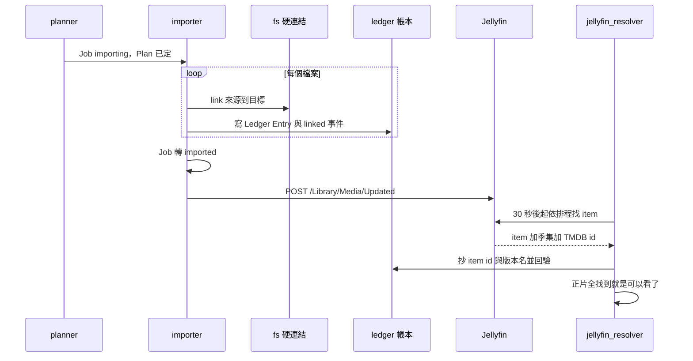

# 入庫、帳本與反查（Ledger Entry / Resolve）

## 用途

計劃通過後，Berth 把檔案放進 Jellyfin 認得的資料夾，記下每一個檔案的來歷，再確認 Jellyfin 真的把它認成對的那一集。使用者看到的是：Job 走到 `imported`，過一陣子作品頁出現「觀看區」、Discord 收到「可以看了」。這一段是整個產品**唯一會在媒體庫裡放東西的地方**（`berth/services/importer.py` 開頭說明）。

## 怎麼運作

**硬連結（hardlink）**：同一個檔案同時出現在 complete（qBittorrent 做種的地方）和媒體庫（Jellyfin 播放的地方），只佔一份空間。`os.link` 失敗（不同磁碟、exFAT、兩個掛載點）就是失敗，**不退回複製**（`berth/adapters/fs.py:link`、brief §4.4）。失敗訊息會說出是哪兩個掛載、要改 compose 的哪幾行。也因為只是多一個名字，撤銷（拆掉鏈接）幾乎零成本，這是敢自動入庫 medium 的前提（brief §6.5）。

**入庫（importer）**：`importer` 迴圈一次一筆 Job，逐檔做一個工作單元：建資料夾 → `link()` → 寫帳本 → 寫 `linked` 事件 → commit（`importer._place`）。中途被關掉，磁碟與帳本最多差最後一個檔案，下一輪補回。

- 目標已存在：與來源同 inode 視為「上次鏈接了、帳本還沒寫」，補帳本；inode 不同就是媒體庫裡本來有別人的檔案，Berth 不覆寫，整筆停在 review（`target_exists`）。判定交給 `link()` 丟的 `FileExistsError`，不先 `exists()` 再鏈接，免得兩步之間有縫（`importer.link_into`）。
- 失敗分兩種：正片鏈接不成 → `import_failed`；字幕或特典不成只記在那一列，那一集仍看得了（`SKIPPABLE`）。
- 全部做完才轉 `imported`，**狀態落地之後**才通知 Jellyfin 掃描（`POST /Library/Media/Updated`）；通知失敗只記事件，不擋（plan §3.3）。

**帳本（Ledger Entry）**：一條「來源檔案 → 目標硬連結」的紀錄，含來源路徑、目標路徑（unique）、inode、作品季集、Tags、Jellyfin item id（`berth/models/ledger.py`）。它是 Berth 的核心資產：回答「這個媒體庫檔案來自哪個 torrent」「哪些鏈接斷了」，也讓刪除能分範圍、重新入庫能跳過已完成的檔案（brief §7.9）。帳本**以來源冪等**：同一 Job 的同一個來源永遠是同一列，所以 TMDB 改了集名時，那一列換新路徑、舊鏈接（同 inode 的才收）被拆掉，Jellyfin 不會多出同一集的第二版本（`importer._ledger_rows`，brief §9.3）。

**反查（Resolve）**：通知只是「去看看」，Jellyfin 自己排程掃描，掃完才有 item。所以 `jellyfin_resolver` 對每條帳本各自排程反查：入庫後 30 秒 → 1 分 → 10 分 → 1 小時 ×3，共 6 次，下一次時間存在 `ledger.resolve_after`，重啟不會忘（`services/resolve_schedule.py`）。找法是比路徑（也比 `MediaSources[].Path`，因為第二個版本不是 item 自己的路徑）。沒找到時再通知一次，必要時請 Jellyfin 掃描：該媒體庫已有內容就只刷新那個庫，空的媒體庫第一次入庫就跑整台掃描。

**Jellyfin 回驗**：找到後比三件事，Jellyfin 認的季號、集號、作品的 TMDB id 要與帳本一致，不一致開 `jellyfin_item_mismatch`（`resolver.disagreement`）。Jellyfin 還在認（季集是空、作品沒 TMDB id）不算不一致，繼續排程，最晚 10 分鐘再問。**它抓得到 Jellyfin 那邊的意外，抓不到 Berth 自己算錯的集數**，因為 Jellyfin 認集數靠的就是 Berth 取的檔名（brief §6.10）。

**「可以看了」**：一筆 Job 的正片**全部**在 Jellyfin 找到時，寫一筆 `jellyfin_item_resolved(count)`，一筆 Job 只寫一次，同一個交易排進「可以看了」通知（`resolver._announce`）。六次都沒找到則開 `jellyfin_item_unresolved` Issue。

## 例子

接 import-plan.md 的例子（路徑為示意，Route 根目錄依設定而定）：

| 項目 | 值 |
| --- | --- |
| 來源（complete） | `/data/complete/<route-slug>/[SubsPlease] Spy x Family - 05 (1080p) [547FDE9F].mkv` |
| 目標（media library） | `<Route 目標>/SPY x FAMILY (2022) [tmdbid-120089]/Season 01/SPY x FAMILY (2022) - S01E05 - WILL THEY PASS OR FAIL [1080p][SubsPlease].mkv` |
| 帳本 | `season=1, episode_start=5`、`audit=true`（medium）、兩端同一個 inode、`resolve_after = 入庫 + 30 秒` |
| 約 30 秒後 | 反查：Jellyfin 回 Episode S01E05、Series 的 `ProviderIds.Tmdb = 120089`，與帳本一致 → 記 item id 與版本名 |
| 全部正片找到 | `jellyfin_item_resolved` → 「可以看了」 |

## 流程圖

規劃器把 Job 交給 importer 後，importer 逐檔鏈接並寫帳本，全部成功才轉 `imported`，然後請 Jellyfin 去掃。`jellyfin_resolver` 另按排程向 Jellyfin 問每條帳本對應的 item，找到就把 item id 和版本名寫回帳本並回驗季集與 TMDB id，一筆 Job 的正片都找到時宣告可以看了。

## 帳本壞了怎麼辦

- **重新入庫（Reimport）**：以 complete 裡的資料夾為來源重走規劃與入庫，不要求 torrent 還在；帳本以來源冪等，所以「刪了媒體庫、留著 complete，一鍵重來」是安全的（`services/reimport.py`、brief §9.3）。
- **`berth rebuild-ledger`**：帳本整個沒了（還原舊備份）時，用 inode 反查 complete、路徑依命名模板讀回季集才長回一列；配不上的一律成為 `unmanaged_library_file`，不猜（`services/ledger_rebuild.py`）。
- 每日對帳（Reconciler）比帳本、qBittorrent、complete、媒體庫四方，另文說明。

## 涉及的模組

`berth/services/importer.py`、`resolver.py`、`resolve_schedule.py`、`reimport.py`、`ledger_rebuild.py`；`berth/adapters/fs.py`（連結與路徑守衛）、`adapters/jellyfin/`；`berth/models/ledger.py`；`berth/pipeline/importing.py`、`resolving.py`（迴圈：importer 事件 + 60 秒，resolver 每 15 秒醒）。

## 相關決定

- [ADR-0002](../../adr/0002-jellyfin-12-minimum-pinned-image.md)：只支援 Jellyfin 12 以上，12 原生把同季同集的檔案併成多版本，所以不裝 MergeVersions。
- [brief §4.4](../../design-brief.md)：必須先真的鏈接一次驗證；硬連結失敗不退回複製。
- [brief §7.9](../../design-brief.md)：帳本是必要的核心資產，inode 重建只是備援。
- [plan §3.3](../../plan.md)：冪等與寫交易紀律（先拿 `job_lock`，網路呼叫不在寫交易裡）。

## 限制

- 反查靠延遲重試：實測約 12 分鐘認得出（plan §3.2）。6 次用完才開 Issue；plan 寫「約 42 分鐘」，那只在每次重試都被 10 分鐘上限壓住時成立，否則排程累計約 2 小時（推斷，自 `resolve_schedule.py` 與 `resolver.py:_remind` 推得）。
- Jellyfin 與 qBittorrent 必須共用同一個父目錄掛載；不支援 remote path mapping、網路共享（brief §4.4、§18）。
- 多集檔與「同起始集的單集」一律送 review，因為 Jellyfin 12 的版本分組鍵只有季與集，會把 `S01E03-E04` 與 `S01E03` 併成同一集（brief §7.8）。
- 回驗抓不到 Berth 自己算錯的集數。

## 細節在哪

plan §3.1（`importing` 各列）、§3.2〈`jellyfin_resolver`〉、§3.3、§2.3（`ledger` 欄位）；brief §4、§5.3、§7.9、§9.3、§20.1；`berth/services/importer.py` 與 `resolver.py` 的開頭說明。
