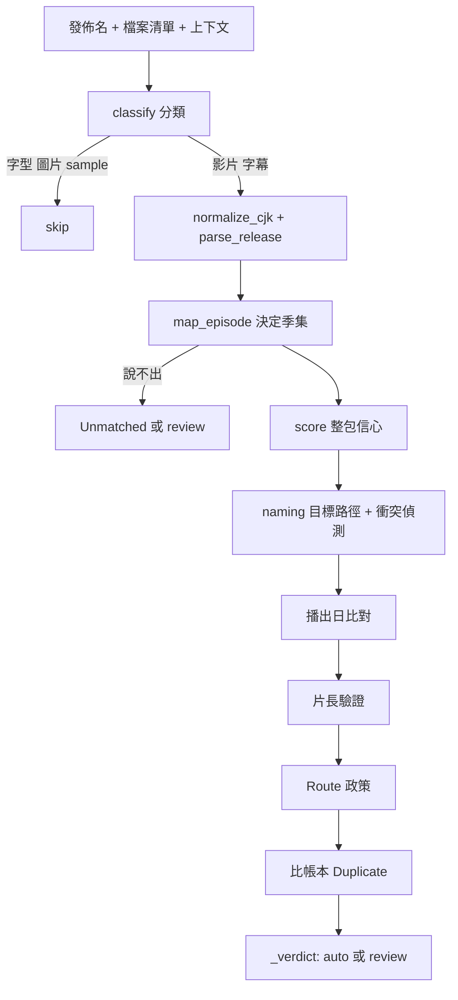
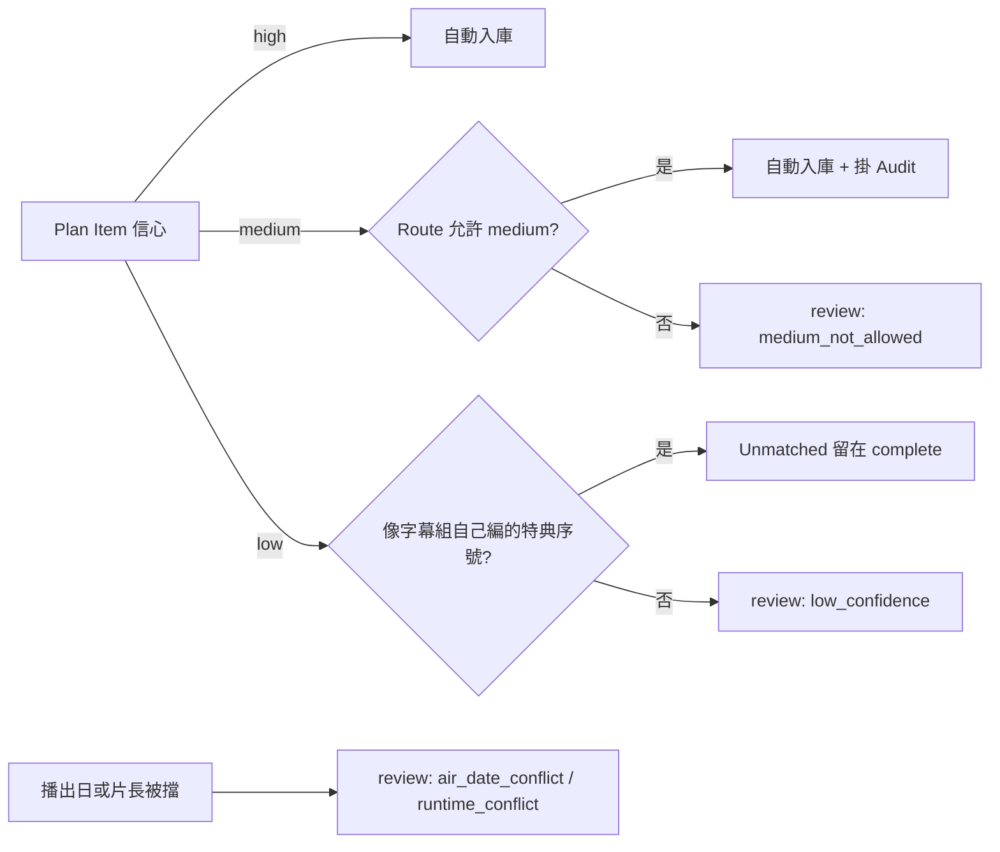

# Import Plan 與解析器（Import Plan）

## 用途

下載好的 torrent 只有一個發佈名和一堆檔案，Berth 要先回答「每個檔案是哪部作品的第幾季第幾集、該放到哪」，才敢動 Jellyfin 的資料夾。這個答案叫 Import Plan（入庫計劃）：逐檔寫好分類、季集、目標路徑、Tags、信心與理由，**套用前不動任何檔案**（`CONTEXT.md`「Import Plan」）。使用者在作品頁的下載列和審核頁看得到它，每一列都附「為什麼這樣判」。

## 怎麼運作

**解析器是一串純函式**：不連網、不讀檔，輸入是發佈名、檔案清單、上下文（作品、季號提示）和 TMDB 快照，輸出是 Plan。因為沒有 IO，同一批資料可以離線重跑，這是 Benchmark 能成立的前提（`berth/parser/__init__.py`、plan §4）。

**階段**（`berth/parser/planner.py:plan`，plan §4.1）：

1. `classify` 依副檔名、大小、資料夾名把檔案分成影片、字幕、字型、特典（extra）、光碟結構等；字型、圖片、sample 直接 skip。
2. `normalize_cjk` + `parse_release`：先用自維護的中文字幕組詞典清掉 `★10月新番`、招募廣告、`【】`，抽出字幕語言、`第01話`、`合集`，剩下的字串交給 guessit。沒有現成函式庫懂字幕組命名，所以自己寫（brief §6.3）。
3. `map_episode`（`berth/parser/mapping.py`）：決定季集。**明說的贏推論的**，依序試：RSS Series 帶的季號、檔名的 `S01E05`、資料夾 `Season 2/`、篇章名（`柱訓練篇` 對到某季的季名）、`Part.2` 的 cour 偏移，最後才是「只有集號」：作品只有一季就直接用，否則當絕對編號換算（brief §6.4）。每個候選帶一個 `MappingStrategy` 和理由。
4. `score`（`berth/parser/score.py`）：整包一起看。數量比 TMDB 該季多、或互相矛盾的整季降 low；少數派策略降 medium。**只往下調，從不把推論升成 high**。
5. `naming` 算目標路徑（plan §5），然後偵測兩檔指到同一路徑：誰都不自動入庫（brief §6.4 第 5 點）。字幕最後才配，因為字幕自己說不出第幾集，只能跟著影片。

**信心三級**（brief §6.5）：high = 季集是明說的；medium = 推論的（絕對編號換算、播出日 offset、篇章名、發佈時間推測）；low = 作品不確定、TMDB 沒有那一集、數量對不上或換算有反證。信心的上限是逐條策略定的，不是一個分數。

**服務層在解析器之後再加三道關**（`berth/services/plan.py:_decided`、`_plan`），順序固定：

- **播出日比對**（`parser/airing.py`）：發佈時間早於換算出那一集的 TMDB 播出日太多（換算的讀法容忍 2 天，照字面的 9 天，因為平台常比電視台先播一週）就停下來。RSS 另有一條：對到的集比發佈當時最近播出的一集早六週以上也停。
- **片長驗證**（`parser/runtime.py`）：mediainfo 量到的片長與 TMDB 差超過 `max(180 秒, 15%)` 就停。抓的是 SP、兩集合併檔被當正片。
- **Route 政策**：Route 關掉 medium 自動入庫時，medium 改成 review。

兩道檢查抓的是「規則層有把握卻算錯」，被擋的列保留季集與目標路徑，核准就照畫面上的位置入庫。缺資料不擋（TMDB 沒片長、沒發佈時間），只記一筆。再來才比帳本找 Duplicate（見 review-queue.md）。

**Pre-plan**：torrent 一拿到檔案清單（`metadata_ready`）就先算一份預估（`plans.status = preplan`），不讀磁碟、不量片長、不動 Job 狀態。用意是下載完成前就看出「這包不對」（`services/plan.py:_preplan`，plan §3.1）。

**結論怎麼落地**（`_verdict`）：全部 high/medium 且 Route 允許 → 自動入庫；否則 review，並帶一個封閉的理由（`ReviewReason`）。Unmatched 不算低信心而是「已做完的決定」，不擋自動入庫。

## 例子

真實語料 `tests/fixtures/parser/anime/spy-x-family-05-subsplease.json`（我用 `parser.plan` 實跑過）：

| 步驟 | 結果 |
| --- | --- |
| 發佈名 | `[SubsPlease] Spy x Family - 05 (1080p) [547FDE9F].mkv` |
| classify / parse | 影片；組 `SubsPlease`、解析度 `1080p`、集號 5、沒有季號 |
| map_episode | 只有集號 + 發佈時間落在剛播的那一輪 → `published_run`，S01E05，**medium** |
| naming | `SPY x FAMILY (2022) [tmdbid-120089]/Season 01/SPY x FAMILY (2022) - S01E05 - WILL THEY PASS OR FAIL [1080p][SubsPlease].mkv` |
| 結論 | medium 且 Route 允許 → 自動入庫，掛 Audit（等人確認） |

實際路徑有年份、`[tmdbid-…]` 和集名，不是 `作品名 S01E05.mkv`：Jellyfin 靠資料夾裡的 tmdbid 鎖定作品（brief §7.1）。中文字幕組的例子是 `dragon-ball-daima-ktxp.json`：`【极影字幕社】★10月新番 … 第01话 GB 1080P` 會被剝成 S01E01、字幕 `CHS`。

## 流程圖

解析器先分類，非影片的直接略過，影片經字幕組詞典清洗後決定季集；說不出季集的變成 Unmatched 或 review，其餘進 `score` 看整包是否互相矛盾。算完目標路徑後依序過播出日、片長、Route 政策和帳本比對，最後 `_verdict` 決定自動入庫或停在 review。

high 直接入庫；medium 看 Route，允許就入庫並掛 Audit，不允許就停下。low 分兩路：像 `[SP][01]` 這種自己編號的特典是 Unmatched，其餘進 review。被兩道程式檢查擋下的列即使信心是 high 或 medium 也停在 review，且理由排在信心前面（`_HELD_BY_CHECKS`）。

## Benchmark 與 `auto_wrong`

`berth bench` 在凍結的真實 torrent 檔案清單（`tests/fixtures/parser/`）上跑解析器，逐檔對照正解，每個檔案落進八個互斥的桶（`services/bench.py:Bucket`）。最嚴重的是 `auto_wrong`：自動處置了但處置錯（包括把正片當 extra 搬走）。門檻：`auto_wrong` 不得高於 `baseline.json`（目前 0），`auto_correct`、`extra_correct`、`subtitle_correct` 不得低於 baseline 減 1（`regressions()`）。`min_confidence` 不參與對錯，只回報「本來該自動入庫的少了幾個」。改解析器前先加一筆語料（紅燈），改完不得退步。

## 涉及的模組

`berth/parser/`（純函式）、`berth/naming/`（目標路徑）、`berth/domain/parser.py`（`PlanItem`、`MappingStrategy`、`ReasonCode`）、`berth/services/plan.py`（量片長、讀快照、跑檢查、寫 `plans`/`plan_items`）、`berth/pipeline/planning.py`（`planner_runner` 迴圈，事件 + 60 秒）、`berth/services/bench.py`、`web/src/plans/`。

## 相關決定

- [ADR-0003](../../adr/0003-remove-route-profile.md)：移除 Route profile，絕對編號換算改由「集號 ≤ 第一季集數」「播出日對不上」兩條證據決定要不要送審。
- [brief §6.5](../../design-brief.md)：high 與 medium 都自動入庫，medium 掛 Audit，靠硬連結撤銷幾乎零成本。
- [plan §4.4](../../plan.md)：虛擬季門檻 180 天已被 7,833 筆釋出量測支持，不要調小。
- [ADR-0008](../../adr/0008-ai-autonomy-and-optional-ai.md)：規則層是主力，AI 只接 low 的例外（M6，尚未實作）。

## 限制

- TMDB 與字幕組的季編號不一致是最大的誤入庫來源；絕對編號換算只能到 medium（plan §4.4）。
- 推測發佈時間所屬輪次（`published_run`）的盲點：播出中補發前一季舊集，會被讀成現在這一輪，兩道檢查都看不出（plan §4.4）。
- 片長驗證看不出與正片一樣長的番外；同季內算錯的集號它也看不出（plan §4.1）。
- 每集短於 5 分鐘的短篇動畫會整包被降成 extra（plan §11.9）。
- 光碟結構、分割光碟、多部作品合集一律交人（brief §6.2、§6.6）。

## 細節在哪

plan §4.1–§4.4、§4.6、§5；brief §6.2–§6.9；`tests/fixtures/parser/README.md`（語料清單與三條容易讀反的判斷）；`berth/parser/mapping.py`（頂部說明）。AI 解析的設計在 plan §4.5。
