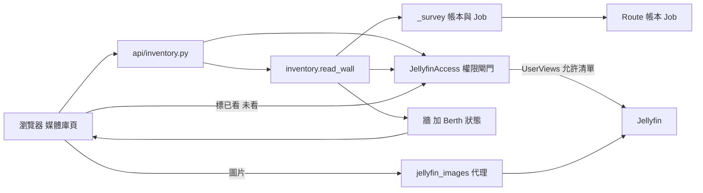

# 媒體庫頁（Inventory、Watch State、Resume、Next Up、Watch Area）

## 用途

媒體庫頁像 Jellyfin 那樣瀏覽整個媒體庫：一個 Jellyfin 媒體庫一頁，只列這位使用者在 Jellyfin 看得到的那幾個。牆上是 Jellyfin 的每一部作品，不只 Berth 入庫的；Berth 經手的作品被疊上入庫狀態（失敗、待審、下載中、完整、部分、空），還沒進 Jellyfin 的另列一條。頁面上方有「繼續觀看」和「下一集」，卡片上有觀看狀態，可標已看或未看，按播放跳去 Jellyfin（`brief §12`、`§13`）。Berth 不內建播放器。

## 怎麼運作

**權限由 Berth 自己擋，只擋在一個入口。** Berth 只有一把 Jellyfin 的 API key，而 Jellyfin 把它當管理員：帶誰的 `userId` 就是誰，帶 `parentId` 的查詢甚至不套媒體庫權限，停用的帳號也照樣讀得到。所以所有讀寫都走 `JellyfinAccess`：`userId` 一律取自 session，媒體庫 id 先對 `UserViews` 的允許清單驗證，不在清單就在問 Jellyfin 之前拒絕（`berth/services/jellyfin_access.py:1`）。允許清單與使用者 `Policy` 快取 60 秒，帳號被停用就結束那個人的 Berth session，最多晚一分鐘（`ACCESS_TTL_SECONDS`）。

**牆是兩份資料疊起來。** `read_wall` 取 Jellyfin 的那一頁（一頁 50 部，分頁與排序照 Jellyfin），同時找出這個媒體庫上 Berth 經手的每一部：指向它的 Route 上有 Job 的，加上帳本目標落在 Route 底下的。配對先比帳本記的 Jellyfin item id，沒有再比 TMDB id。有 Berth 經手作品時才多抓一份整庫清單來配對（`berth/services/inventory.py:303`、`891`）。

**一格只說一件事，需要人的排前面。** 狀態取第一個成立的：失敗、待審、下載中，然後才是完整（已播出的正片都入庫）、部分、空。同時第一季入庫、第二季在下載、有一包待審時，格子說的是「待審」（`InventoryStatus` 宣告順序，`berth/services/inventory.py:1058`）。

**觀看狀態存在 Jellyfin，Berth 不存。** 一格至多說一句：已看、看到 N%（只有影片）、剩 N 集沒看（只有劇集，沒開始看也算），判定照 jellyfin-web 的卡片。Berth 只替那個人寫回「標為已看／未看」，這是唯一的寫入（`berth/services/watch.py:32`）。標為未看會清掉次數與時間，劇集是每一集，所以兩個方向清得掉東西時都先確認。

**作品詳情的 Watch Area 與主按鈕 Carry On。** 作品在 Jellyfin 且這位使用者看得到，詳情頁最上面才有觀看區：主按鈕（繼續看、看下一集、從 S01E01 開始看）加季切換與集清單，電影則直接開那一部。不在 Jellyfin 與看不到是同一個答案：沒有這一塊（`berth/services/watch_area.py:73`）。

**圖片由 Berth 代理。** 瀏覽器只連 Berth，不必連得到 Jellyfin，HTTPS 的 Berth 配 HTTP 的 Jellyfin 也沒有 mixed content。縮放尺寸是固定的具名幾種，網址帶 `tag`，回應快取一年（`berth/services/jellyfin_images.py:31`）。

瀏覽器要牆，`api/inventory.py` 呼叫 `read_wall`；`read_wall` 透過權限閘門向 Jellyfin 要那一頁和整庫清單，同時從 Route、帳本和 Job 算出 Berth 經手的作品，疊成一面牆回給瀏覽器。圖片另走代理，標已看與未看則經同一個閘門寫回 Jellyfin。

## 涉及的模組

- `berth/services/inventory.py`（牆與各集狀態）、`watch.py`、`watching.py`（繼續觀看與下一集）、`watch_area.py`、`jellyfin_images.py`。
- `berth/services/jellyfin_access.py`：權限閘門；`berth/adapters/jellyfin/`。
- `berth/api/inventory.py`、`api/jellyfin.py`；前端 `web/src/inventory/`、`web/src/watching/`。

## 相關決定

- [ADR-0004](../../adr/0004-library-browsing-and-discovery.md)：一個 Jellyfin 媒體庫一頁，Berth 代理圖片，帳號停用要跟上，探索頁只放 TMDB 牆。
- [ADR-0005](../../adr/0005-display-title-follows-ui-language.md)：牆上已在 Jellyfin 的作品顯示 Jellyfin 的名稱，不為每一部查 TMDB。
- [設計簡報 §12、§13、§20.8](../../design-brief.md)：播放跳 Jellyfin、頁面內容、媒體庫瀏覽用的 Jellyfin API。
- [plan §11.2b](../../plan.md)：M1.5 的實作範圍。

## 限制

- 篩選（類型、年份、名字）只套在 Jellyfin 那一頁；Berth 經手清單不分頁，也不套這些篩選。
- Jellyfin 掛掉時整面牆沒有（Berth 沒有自己的帳號，連登入都要 Jellyfin）。
- 圖片不逐張檢查可見性，網址靠猜不到的 item id 與 tag；誰進得來由登入決定。
- 卡片以 Jellyfin 名稱顯示，EN 介面點進詳情頁時標題可能換成另一種語言（ADR-0005 的已知代價）。

## 細節在哪

`plan §6`（inventory、jellyfin 端點群）、`§11.2b`；`brief §12`；`CONTEXT.md`〈Inventory〉〈Watch State〉〈Resume〉〈Next Up〉〈Watch Area〉〈Carry On〉；`docs/archive/m1.5.md`。
