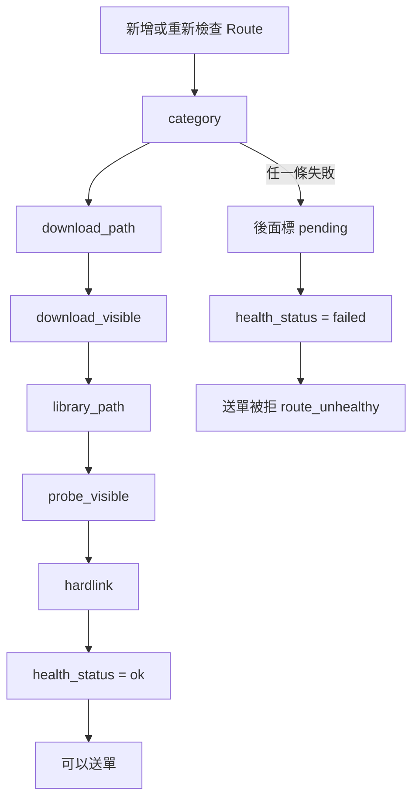

# Library Route 與硬連結檢查（Library Route）

## 用途

Library Route（畫面叫「媒體庫」）是一個入庫目的地：一個 Jellyfin 媒體庫、一條 Berth 寫入的路徑、一個 qBittorrent category 綁在一起（`CONTEXT.md`、`berth/models/route.py`）。送單時選 Route，下載完成後檔案就從這條 Route 的 complete 目錄「硬連結」到它的媒體庫路徑。

硬連結是同一個檔案在兩個資料夾各有一個名字，只佔一份空間。它要求兩個資料夾在同一個檔案系統。所以每條 Route 都要通過一組檢查，確認 Berth、qBittorrent、Jellyfin 三個容器看到的是同一塊磁碟。

## 怎麼運作

**路徑規則。** 下載放 `/data/torrent/incomplete/<slug>`，完成後 qBittorrent 搬到 `/data/torrent/complete/<slug>`，入庫連到 Jellyfin 媒體庫的某一條路徑。slug 由媒體庫名稱算出，category 預設 `berth-<slug>`（`design-brief.md` §4.1）。路徑一律從 Jellyfin 讀，你只做選擇，不手打（`routes.py` 的 `create_route` 拒絕不在媒體庫 `locations` 裡的目標）。

**六條檢查，依序跑，前一條失敗就停。** `RouteCheck` 的宣告順序（`berth/domain/enums.py`）：

1. `category`：在 qBittorrent 建 category（帶自己的未完成目錄）；已存在但路徑不同就報衝突，不覆寫。
2. `download_path`：qBittorrent 回報的路徑，Berth 這個容器看得到。
3. `download_visible`：反過來，Berth 寫探測檔，請 qBittorrent 用探針 torrent 校驗到 100%。
4. `library_path`：向 Jellyfin 現查，寫入目標仍是該媒體庫的路徑之一。
5. `probe_visible`：Berth 在目標寫探測檔，Jellyfin 的 `ValidatePath` 看得到。
6. `hardlink`：真的建暫存檔、`link()` 一次、比 inode，再清掉（`adapters/fs.py` 的 `link_test`）。只比 `st_dev` 不夠，btrfs 子卷、ZFS dataset、mergerfs 都會騙過它，所以一定實際連一次。

斷了就停，是因為後面的檢查測的會是錯的路徑，一起變紅只會蓋掉真正原因（`routes.py` 的 `_check`）。

**結果與送單。** 逐條結果寫進 `routes.health_detail_json`；總結 `ok` / `failed` / `unknown` 由 `_verdict` 算。送單時 `failed` 的 Route 會被拒（`jobs.py` 的 `check_route`，`route_unhealthy`），`unknown`（還沒檢查）放行。連結失敗不退回複製，因為複製會讓刪除範圍和空間估算失真（brief §4.4）。

**建立、修改、刪除。** 新增 Route 先停用，檢查全綠才啟用；停用到啟用要重跑一輪全綠。slug 和目標路徑建立後不能改，要換就新增一條再刪舊的。被 Job、帳本、RSS 引用的 Route 刪不掉，出路是停用（`create_route`、`update_route`、`delete_route`）。

檢查從建 category 開始，一路驗證到真的硬連結一次。任何一條失敗，後面的標成 `pending`，Route 變 `failed`，之後送單會被拒。六條全過才是 `ok`。這組檢查精靈第 3 頁跑一次，之後每 5 分鐘由 [健康頁](health-check.md) 的迴圈重跑。

## 涉及的模組

- `berth/services/routes.py`：建立、檢查、刪除，`_Checker` 是六條檢查本體。
- `berth/models/route.py`：`Route`、`RouteHealth`；`berth/adapters/fs.py`：`link_test`、`probe_file`。
- `berth/services/jobs.py`：送單時擋紅燈 Route。
- 前端：`web/src/pages/RouteSettingsPage.tsx`、`web/src/settings/AddRoute.tsx`。

## 相關決定

- [設計簡報 §4](../../design-brief.md)：三層路徑固定在 `/data` 底下；一個媒體庫可有多條 Route；硬連結失敗不退回複製。
- [ADR-0003](../../adr/0003-remove-route-profile.md)：Route 不再有 anime / standard 的 profile 欄位，絕對編號換算改由證據決定。
- [ADR-0013](../../adr/0013-berth-manages-only-its-own-objects.md)：qBittorrent 只建 `berth-*` 分類，不寫全域偏好；既有 Jellyfin 加的是一條 Berth 路徑，舊路徑原地不動。

## 限制

- 三個容器必須用相同容器路徑 `/data` 掛同一個宿主父目錄；Docker Desktop 的 bind mount、mergerfs、跨 dataset 可能做不了硬連結（`docs/guide/requirements.md`）。
- 5 分鐘的健康迴圈不跑 `download_visible` 探針，沿用上一次結果，因為探針會觸發使用者 qBittorrent 的「完成時執行外部程式」（`routes.py` 的 `check_routes`）。
- 已啟用的 Route 變紅不會被自動停用，只是送單被擋（`update_route` docstring）。

## 細節在哪

`design-brief.md` §4.1–4.4、`plan §9.5`、`plan §2.2`、`docs/guide/requirements.md`；程式 `berth/services/routes.py`。
