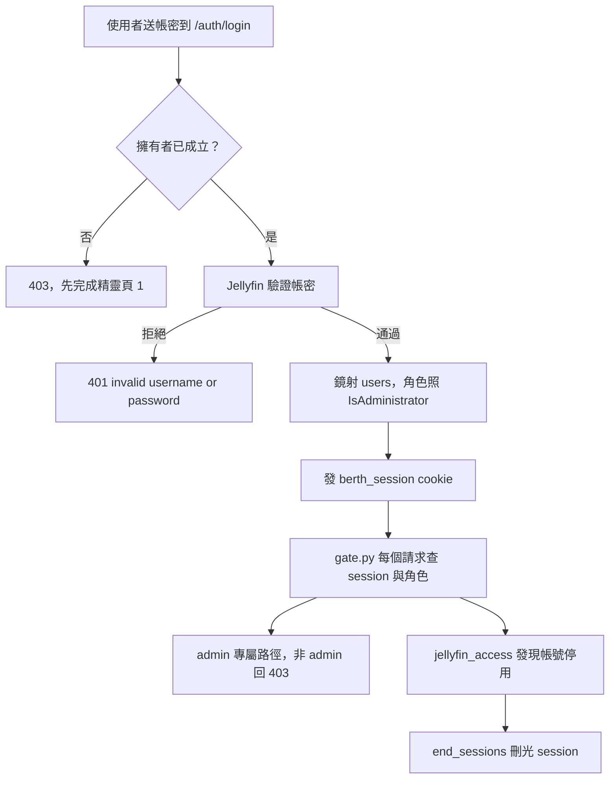

# 登入與角色（Role）

## 用途

你用 Jellyfin 的帳號密碼登入 Berth。Jellyfin 的管理員在 Berth 是 `admin`，其他人是 `user`。admin 能改設定、審核、處理 Issue、刪除；user 能探索、送單、看自己的 Job。Berth 自己沒有密碼系統（`design-brief.md` §11）。

## 怎麼運作

**密碼只交給 Jellyfin 驗。** `/auth/login` 把帳密轉給 Jellyfin，通過後 Berth 發自己的 session，之後每個請求只認那張 cookie，不必每次再問 Jellyfin（`berth/services/auth.py` 的 `sign_in`、`_authenticate`）。「帳號不存在」和「密碼錯」用同一句拒絕，避免被拿來列舉帳號。Jellyfin 連不上時回 503，和密碼錯是兩種錯誤，畫面才說得出差別。

**角色來自 Jellyfin，每次登入重寫。** 本地的 `users` 表只是鏡射：名字和角色每次登入都照 Jellyfin 的 `IsAdministrator` 更新（`_mirror_user`）。

**session 是 cookie。** 名叫 `berth_session`，httpOnly、`SameSite=Strict`，30 天絕對壽命、不滑動續期；資料庫只存 token 的雜湊（`SESSION_TTL`、`token_digest`、`api/auth.py`）。刻意不設 `Secure`，因為自架多半是區網純 HTTP，HTTPS 交給前置代理。

**門禁是 middleware，預設拒絕。** `berth/api/gate.py` 擋在 `/api` 前面：非 GET 要帶 `X-Requested-With`（CSRF 第二層）；沒有 session 回 401；匿名白名單只有 `/health`、`/auth/login`、`/auth/logout`。admin 專屬的分兩種：整塊前綴（`ADMIN_PREFIXES`，如 `/settings`、`/routes`、`/issues`、`/review`、`/weekly`）和單一動詞（`ADMIN_ROUTES`，如 `DELETE /jobs/*`、`POST /plans/*/approve`）。新端點什麼都不做就已經在門後。

**精靈期間的特例。** 擁有者（頁 1 的 Jellyfin 管理員）成立之前，`/auth/login` 一律拒絕（`OwnerPendingError`），匿名只能打開場那幾支精靈端點（`SETUP_OPENING_PATHS`）。成立之後整組 `/setup/*` 只有 admin 進得來（`_setup_verdict`）。見 [設定精靈](setup-wizard.md)。

**Jellyfin 停用帳號，Berth 跟著結束 session。** Berth 用一把伺服器 API key 代使用者讀 Jellyfin，而 API key 讀得到已停用帳號的資料。所以 `jellyfin_access` 在每次替某人讀 Jellyfin 時，順便查他的 `Policy`，發現停用或已刪除就刪掉他所有 session（`_grant`、`end_sessions`）。這份判斷快取 60 秒（`ACCESS_TTL_SECONDS`）。

登入先確認擁有者已成立，再把帳密交給 Jellyfin。通過後 Berth 更新本地鏡射並發 cookie。之後每個請求都過 `gate.py`：admin 專屬路徑對非 admin 回 403。另一條路是，當 Berth 替這個人讀 Jellyfin 時發現帳號被停用，就把他的 session 全部刪掉。

## 涉及的模組

- `berth/services/auth.py`：登入、session、鏡射、`end_sessions`。
- `berth/api/auth.py`：`/auth/login`、`/auth/logout`、`/auth/me`、cookie 設定。
- `berth/api/gate.py`：CSRF、登入檢查、admin 規則。
- `berth/services/jellyfin_access.py`：替使用者讀 Jellyfin 的權限閘門與停用偵測。
- 前端：`web/src/auth/`、`web/src/pages/LoginPage.tsx`。

## 相關決定

- [設計簡報 §11](../../design-brief.md)：沿用 Seerr 做法，以 Jellyfin 帳號登入；不自建密碼；Jellyfin 掛掉就沒人登得進來，可接受。
- [ADR-0012](../../adr/0012-owner-is-jellyfin-admin.md)：擁有者就是 Jellyfin 管理員，擁有者成立前 `/auth/login` 一律拒絕。
- [ADR-0004](../../adr/0004-library-browsing-and-discovery.md)：帳號停用靠瀏覽時查 `Policy` 結束 session，不縮短 session 效期。
- [ADR-0006](../../adr/0006-review-and-issues-split.md)：審核、Issue 動作、rematch、刪除範圍、手動對帳一律只有 admin。

## 限制

- Jellyfin 掛掉時沒有人登得進來（brief §11 接受的取捨）。
- 角色只在登入時更新。你在 Jellyfin 把某人降為非管理員，他已登入的 session 仍帶舊角色，最長 30 天（推斷，依 `auth.py` 的 `read_session` 只讀本地 `users` 列；沒找到定期同步的程式碼）。
- 停用帳號的偵測只發生在 Berth 替那個人讀 Jellyfin 的時候，不是背景輪詢；只用不碰 Jellyfin 的頁面時，session 會留到到期（推斷，依 `jellyfin_access` 的呼叫點）。
- 前端隱藏按鈕不是安全機制，後端同時回 403（`plan §7`）。

## 細節在哪

`plan §6〈門禁與 session〉`、`design-brief.md` §11、`berth/api/gate.py` 檔頭註解。
