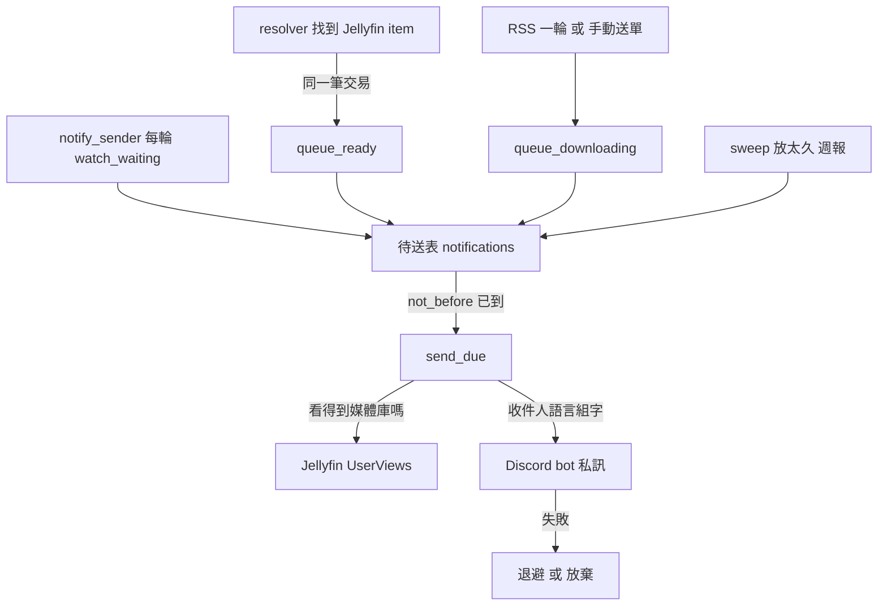

# 通知（Notification、Notification Outbox、Channel）

## 用途

Berth 平常不必打開：有事時它會傳 Discord 私訊給你。四種通知：「可以看了」（一筆下載的正片在 Jellyfin 全部認出來）、「正在下載」（RSS 一輪或有人手動送的下載）、「有 N 件等你處理」（待審核、開著的 Issue、待綁定的 RSS Series 有新的一件，只送管理員）、週報摘要（只送管理員）。每個人在 `/settings/notifications` 填自己的 Discord ID、勾要收哪幾種；管理員多設 bot token（`plan §6`、`CONTEXT.md`）。

## 怎麼運作

**通知先寫進資料庫的待送表，由獨立迴圈送出。** 觸發它的狀態變更（例如 resolver 寫下「Jellyfin 找到了」）與寫待送表在同一筆交易，所以觸發失敗 rollback 時沒有通知；而 Discord 壞掉不會擋住入庫（`berth/services/notify.py:1`）。`notify_sender` 每 10 秒醒一次，撈出「到時間、還沒送」的列送出去，一則一則 commit，網路呼叫不放在寫交易裡（`berth/pipeline/notifying.py:25`、`berth/services/notify.py:757`）。

**待送表存的是事實，句子在送出那一刻才組。** 存作品、季集、Route；送出時照收件人自己的語言（存 Discord ID 那一刻的介面語言）組字。這是後端第一個自己寫人話的地方，其餘句子都在前端的 i18n key（`berth/services/notify.py:1`、ADR-0015）。

**短時間內的同類通知會合併。** 「可以看了」寫入時最早送出時間是 5 分鐘後；同一個人、同一部作品、同一條 Route 在這段時間的下一筆，季集範圍併進同一列，所以一次入庫一整季不會變成一集一則（`MERGE_WINDOW`，`berth/services/notify.py:223`）。「正在下載」一輪已是合成過的單位，不再等。

**只送給看得到那個媒體庫的人。** 收件人是訂閱了該種類、有 Discord ID 的人；說的是某個媒體庫的作品（可以看了、正在下載）時，送出那一刻再問 Jellyfin 的 `UserViews`。看不到或帳號停用就放棄；Jellyfin 問不到就延後，不猜（`berth/services/notify.py:879`）。人手按的下載不會通知按的那個人。

**「等你處理」是看守出來的，不是哪個狀態變更寫的。** 送出迴圈每一輪先比對三份清單與上一輪的差，新出現的才排（等 10 分鐘合併），送出前再看一次，這一波都處理掉了就放棄；第一次看只記下來不排，避免升級當天灌一堆（`watch_waiting`，`berth/services/notify.py:637`）。

**故障分三層，下一步不同。** 管道壞了（token 被拒就整個暫停到換 token；連不上就退避，30 秒起加倍到 1 小時；限速就照 `retry_after` 等）、這一則壞了（超長或組不出句子，當場放棄）、這位收件人到不了（記在他身上，設定頁會說）。任何一則滿 24 小時還沒送到就放棄，因為晚一天才到的「可以看了」已經不是原意，token 修好後一次湧出積壓也比沒收到更吵（`GIVE_UP_AFTER`，`berth/services/notify.py:247`）。

三條路把通知寫進待送表：resolver 認出 Jellyfin 項目時寫「可以看了」，送單時寫「正在下載」，送出迴圈與每日巡檢寫「等你處理」和週報。`send_due` 撈出時間到的列，問 Jellyfin 收件人看不看得到那個媒體庫，用收件人的語言組字後經 Discord 私訊送出；失敗的依類型退避或放棄。

## 涉及的模組

- `berth/services/notify.py`（寫入、送出、設定）、`weekly.py`（週報通知）、`downloading.py`（正在下載）、`waiting.py`（等你處理的清單）、`recipients.py`、`deeplink.py`（訊息裡的連結）。
- `berth/pipeline/notifying.py`：送出迴圈；觸發點在 `services/resolver.py`、`services/sweep.py`。
- `berth/adapters/notify/`（Discord adapter 與 Fake）；前端 `web/src/pages/NotifySettingsPage.tsx`。

## 相關決定

- [ADR-0015](../../adr/0015-notifications-discord-dm.md)：管道只做 Discord bot 私訊，不做 Telegram 與頻道 webhook（頻道裡人人看得到全部，破壞媒體庫權限）；用收件人自己的語言寫。
- [設計簡報 §14、§20.23](../../design-brief.md)：通知種類與 Discord 的實測事實。
- [plan §3.2、§11.5](../../plan.md)：`notify_sender` 的排程與 M4 範圍。
- 不做頻道 webhook 是 2026-10-21 定的（`CONTEXT.md`〈Channel〉，決定者不明）。

## 限制

- 只有 Discord 私訊；管理員要先到 Discord 開發者後台建 bot，每人自己填 user ID。Discord 對話與按鈕要到 M7。
- 沒設 `public_url` 的話訊息不附 Berth 連結；Discord 不收沒有點的主機名（例如 `http://berth:8000`）作為連結（`brief §20.23`）。
- 待送表是活過重啟的，但 Discord 與 Jellyfin 都不在時，24 小時後的通知會被放棄，不補送。
- 遲到（`episodes_overdue`）沒有獨立種類，是併在「等你處理」的內文裡，一次最多列 5 部作品（`_OVERDUE_SHOWN`）。

## 細節在哪

`plan §11.5`、`§3.2`（notify_sender）；`brief §14`、`§20.23`、`docs/research/discord-notifications.md`；`CONTEXT.md`〈Notification〉〈Notification Outbox〉〈Channel〉。
