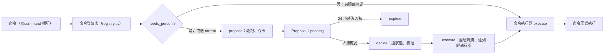

# Proposal 確認卡與命令登錄表（Proposal / Command Registry）

## 用途

Berth 裡「誰能做什麼」只由一份清單決定：命令登錄表。每個會改狀態的動作都是一個有名字的命令，標了副作用等級；不可逆或有風險的，做成 Proposal（確認卡）等人按。使用者看到的是助理對話裡的卡片，可逐列勾選、選 Route 與字幕組，按確認才執行。卡片隔天早上也按得下去。

## 怎麼運作

**命令登錄表（`berth/services/registry.py`）**：`berth.services` 裡每個有 `@command` 標記、不帶 `INTERNAL` 旗標的公開函式，自動收進來。現在共 177 筆（我用 `commands()` 數的）：read 88、reversible 70、irreversible 19，其中 50 個永遠要人。輸入模型由函式簽名推出（伺服器注入的參數如 session、user_id 不進輸入）。

標記有三樣（`berth/services/commands.py`）：

- **Effect**：`READ` 只讀、`REVERSIBLE` 做了能回去、`IRREVERSIBLE` 回不去。
- **inverse**：反向命令，三種寫法（指名、指向自己、`None`）。
- **flags**：`CONNECTS_OUT`（連到新位址）、`SENDS_OUT`（對外發訊息）、`DOWNLOADS`（送 torrent）、`SETTINGS`（改設定）、`INTERNAL`（不進登錄表）。

**要不要人只有一條規則：`needs_person`**。不可逆，或帶 `CONNECTS_OUT`、`SENDS_OUT`、`SETTINGS` 任一個，就永遠要人。M6 的人 / AI 開關也看它。對話裡的卡片範圍更大：送 torrent 與讀過外部內容之後的自由文字寫入也出卡（`agent.needs_card`）。

**命令執行器（`berth/services/executor.py`）**：API、AI 工具、Proposal 都走同一條路：查登錄表、照 `audience` 擋角色、驗輸入、注入伺服器手上的東西與 actor、事後替動到的 Job 推 SSE 並叫醒規劃器或 importer。

**Proposal（`berth/services/proposals.py`）** 的生命週期：

1. `propose`：每列過輸入模型並乾跑 `validate`，有一列不過就不建卡。Route 在這裡定。存的參數算雜湊。
2. `decide`：只有提出者或管理員按得到。先用 compare-and-set 搶狀態，連按兩次只算一次。**核准就當場執行**，不等對話恢復。
3. `execute`：重算雜湊，對不上就一列都不做；逐列經執行器重驗再執行，每列結果與改動同一筆 commit。做事的人是提出者，AI 提的記 `ai:<user id>`，角色用他現在的。
4. 24 小時沒人按就過期（`PROPOSAL_TTL`），`sweeper` 每分鐘清一次。

`decide`、`execute`、`propose` 都標 `INTERNAL`，所以 AI 的工具裡永遠沒有「核准」。

## 流程圖

登錄表從標記建好後，每個命令先看 `needs_person`。不需要人的直接經執行器執行；需要的先乾跑並存成 Proposal，等人按。按確認後 `decide` 搶到狀態，`execute` 驗過雜湊才逐列走回同一個執行器，所以卡片和直接呼叫用的是同一套檢查。

## 涉及的模組

- `berth/services/commands.py`（標記與 `needs_person`）、`registry.py`、`executor.py`、`proposals.py`
- `berth/models/proposal.py`、`berth/api/proposals.py`（列出與 `decide`）
- `berth/domain/enums.py`（`ProposalStatus`、`ProposalRefusal`）
- 前端確認卡：`web/src/agent/ConfirmCard.tsx`
- 守門測試：`tests/unit/test_command_marks.py`（有沒有標、inverse 指不指得到）、`test_command_registry.py`（簽名推得出輸入）

## 相關決定

- [ADR-0008](../../adr/0008-ai-autonomy-and-optional-ai.md)：自主權看可不可以撤銷；新命令一律先標等級與反向命令。
- [ADR-0016](../../adr/0016-ai-agent-architecture.md)：對話裡哪些動作出確認卡見 brief §14。
- [brief §14](../../design-brief.md)：卡片參數由伺服器存、Route 由伺服器定、字幕組由人選。

## 限制

- **新增公開 `async def` 沒標 `@command` 會讓測試紅**，沒有豁免；收 ORM 列或函式的要改注入或標 `internal`（`CLAUDE.md`）。
- 標記寫錯（例如把不可逆的標成可逆）只有「判斷過的那幾支命令」有測試守，其餘靠人審（`test_command_marks.py`，守的範圍為推斷）。
- 執行到一半行程死掉的卡停在 `executing` 不重跑，避免重送 torrent。
- `card_downloads`（一張卡最多 13 個 torrent）目前設定頁沒有這一格（`berth/models/setting.py` 的註解）。

## 細節在哪

`berth/services/commands.py`、`proposals.py`、`executor.py` 的開頭 docstring；brief §14；plan §2.6、§6〈命令執行器〉、§11.6；名詞見 `CONTEXT.md` 的 Proposal、Command Registry、Command Executor、Actor。
