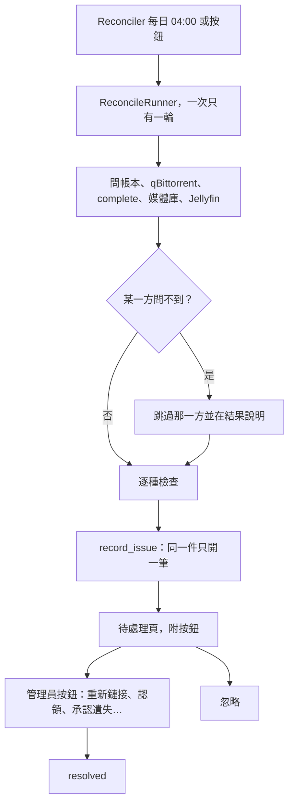

# 對帳與 Issue（Reconciler / Issue / Claim）

## 用途

對帳（Reconciler）每天比一次「Berth 的帳本、qBittorrent、complete 目錄、媒體庫目錄」四方是否一致，另加第五方 Jellyfin。對不上的寫成 Issue，放在「待處理」頁，每件附按鈕（重新鏈接、認領、承認遺失、忽略…）。Berth 永遠不自動刪檔：Issue 只列出，動手的是你按的按鈕（`design-brief.md` §9.1）。

## 怎麼運作

**先問完各方，再寫 Issue。** 一輪對帳依序問四方加 Jellyfin（`ReconcileSide`），再逐種檢查（`berth/services/reconcile.py` 的 `reconcile_once`）。分兩段是為了誠實：任一方問不到就跳過那一方並在結果上說出來，而不是當成「不見了」。qBittorrent 掛掉時帳本上每個 torrent 看起來都不在，照「查不到就是沒有」寫，會產出一份把整個媒體庫報成失蹤的清單，你可能因此按下「承認刪除並清帳本」。媒體庫那一方是逐 Route 問，一條沒掛上不影響其他條。

**Issue 有固定型別，共二十種。** 與對帳直接相關的（`CONTEXT.md`「Issue」）：

- 對帳七種：`library_link_missing`、`source_missing`、`inode_mismatch`、`orphan_complete`、`unknown_torrent`、`unmanaged_library_file`、`job_without_files`。
- Jellyfin 回驗一種：`jellyfin_item_mismatch`，比 Jellyfin 認的季集和作品 TMDB id 與帳本是否一致。
- 其餘來源：管線四種（`missing_files` 等）、[健康頁](health-check.md) 兩種、[巡檢](sweep-and-weekly-report.md) 六種。它們共用同一張 `issues` 表。

**冪等鍵與忽略。** 同一個 `(type, subject)` 只有一筆 `open`，再偵測到就更新它而不是開第二筆（`issues.py` 的 `record_issue`）。「忽略」預設是「這一次不處理」，下一輪還在就開新的一筆。週期量測的那十種（`STAYS_IGNORED`：健康檢查、回驗、`unknown_torrent`、巡檢）則是忽略在條件持續期間有效，條件解除過一次再發生才重開。

**按鈕由後端算。** 每種型別有固定的按鈕集合（`ISSUE_ACTIONS`），再依這一筆的資料篩出現在按得下去的（`_actions`）。例如大小不同的 `inode_mismatch` 不給「以硬鏈接取代」，因為多半是被轉碼過。每顆按鈕做完才記成 resolved，做不到就丟錯、Issue 仍開著。會刪東西的按鈕按下去前再確認一次世界，因為偵測在早上，按下去在下午。

**認領（Claim）。** 把 Berth 不認得、但確實存在的東西收回來，走既有的入庫路線，不刪任何東西（`claims.py`）：孤兒目錄 → 重新入庫（由 admin 選作品）、無主 torrent → 建一筆停在 `submitted` 的 Job、媒體庫裡的陌生檔案 → 用 inode 反查 complete，再照命名模板反解路徑長回帳本一列，配不上的不猜。

**系統自己收的。** 管線三種在 Job 離開壞掉狀態時收掉（`close_settled`，poller 每輪叫）；回驗一致了也收（`settle_verdicts`）。

排程或手動觸發都交給 `ReconcileRunner`，同時間只跑一輪。各方問完後逐種檢查，每個發現都經 `record_issue` 冪等地寫成 Issue。你在待處理頁按按鈕解決，或選忽略；某些種類條件消失時由系統收掉。

## 涉及的模組

- `berth/pipeline/reconciling.py`：每日 04:00（容器 `TZ`）排程，每分鐘醒一次，跨過 04:00 才開一輪。
- `berth/services/reconcile.py`：一輪本身與 `ReconcileRunner`。
- `berth/services/issues.py`：記錄、清單、所有按鈕命令；`claims.py`：三種認領；`resolver.py`：Jellyfin 回驗。
- 前端：`web/src/issues/`、`web/src/pages/IssuesPage.tsx`。

## 相關決定

- [ADR-0006](../../adr/0006-review-and-issues-split.md)：`/review` 只列入庫決定，`/issues` 是「Berth 與外界對不上」；動作一律只有 admin。
- [設計簡報 §9.1](../../design-brief.md)：每種 Issue 的判定、預設動作和忽略的有效期。
- `plan §3.2`〈reconciler〉、`plan §2.4`：排程與資料模型。

## 限制

- 重啟不會立刻對帳，第一次排程從啟動前的最近一個 04:00 算起；剛好在 04:00 前重啟的那天會跳過，但可手動按（`pipeline/reconciling.py` 檔頭）。
- 錯過的天數不補跑。精靈沒完成不跑。
- 進度只存在記憶體，重啟後 `GET /reconcile` 說「還沒跑過」；真正留下的是 `issues` 表。
- 對帳只能抓 Jellyfin 那邊的意外，抓不到 Berth 自己算錯的集數（`CONTEXT.md`「Jellyfin 回驗」）。

## 細節在哪

`design-brief.md` §9.1、`plan §2.4`、`plan §3.2`、`berth/services/reconcile.py` 與 `issues.py` 檔頭。
