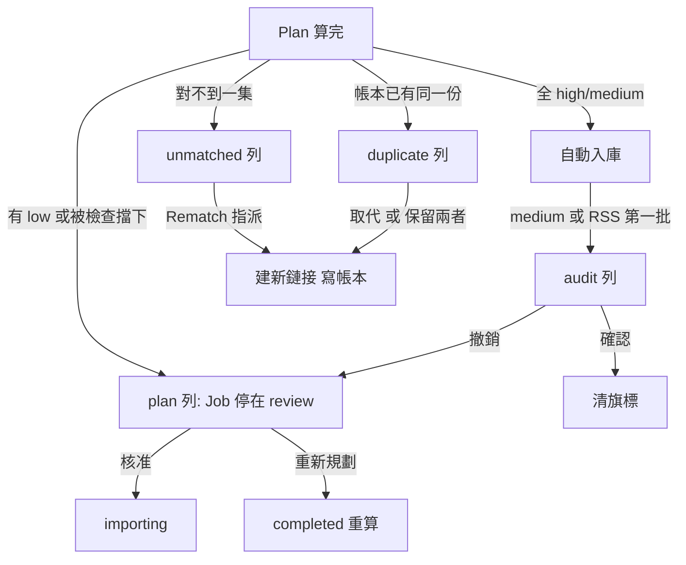

# 審核佇列（Review Queue）

## 用途

規則層沒把握、或做完後值得人看一眼的事，都集中在 `/review` 一份清單，一列一件事，**只有 admin 看得到**（`CONTEXT.md`「Review Queue」）。管理員在這裡核准、改正、撤銷或指派，不用去翻每個 Job。四種列：

| 種類 | 意思 | 狀態 |
| --- | --- | --- |
| `plan` 低信心 Plan | Job 停在 `review`，檔案還沒動 | 等人才能繼續 |
| `unmatched` 對不到 | 影片或字幕對不到 TMDB 任何一集，留在 complete | 等人指派，否則不入庫 |
| `audit` 已入庫待確認 | medium 已自動入庫，掛了旗標 | 已在媒體庫，等人看一眼 |
| `duplicate` 重複版本 | 規劃時發現帳本已有同一份，被略過 | 新的那份留在 complete，等人決定 |

排序：需要人動手的（`plan`、`unmatched`）排前面，已在媒體庫的（`audit`、`duplicate`）次之，同級舊的在前；最多回 200 列並帶 `total`，超過時該修上游，不加分頁（`berth/services/review.py:QUEUE_LIMIT`、`domain/enums.py:REVIEW_PRIORITY`）。

## 怎麼運作

**佇列本身不偵測任何東西**，只是讀資料庫裡已經存在的標記（`services/review.py` 開頭）：`plan` 讀 `plans.status = pending_review` 且 Job 也在 `review`；`unmatched` 讀 `plan_items.action = unmatched`（光碟結構不列，免得一包 BDMV 塞滿幾百列）；`duplicate` 讀 `plan_items.duplicate_of`；`audit` 讀帳本上的 `audit` 旗標（importer 從 Plan Item 抄過去）。Issue 不在這裡，只在 `/issues`（ADR-0006）。

**低信心 Plan 的三個動作**（`services/plan_review.py`，改狀態前都在該 Job 的鎖裡重讀，兩個分頁同按時後到的得到 `not_pending`）：

- **逐列改**：改處置與季集，之後整份重算目標路徑和字幕附掛（`parser.revise`，與規劃同一份規則）；不合法的整批拒絕。改正一集還能「套用到整個 RSS Series」，寫回季號與 offset。
- **核准 = 照提案入庫**：待審核的列季集完整就升成 `import`，寫下的路徑就是畫面上顯示的那條；升成入庫的列寫入前**與帳本再比一次**，因為等人的期間帳本可能已多了同一集。然後 `review → importing`，importer 照這份鏈接，核准不另走一條入庫路。
- **重新規劃（舊稱拒絕）**：丟掉這份（連同逐列改過的）、`review → completed`，規劃器照最新 TMDB 資料整份重算；檔案不動。

**Audit 的兩顆**（`review.confirm_audit`、`undo_audit`）：確認只清旗標，檔案留著；**撤銷**先拆硬連結，拆成了才刪帳本那一列並讓 Job 回 `review`（理由 `audit_undone`），那一列回到「沒有提案」，因為撤銷說的是「這一集不對」，原樣再核准不行。順序不能反：反過來拆不掉時會留下沒帳本的媒體庫檔案。RSS Series 的第一批在這裡以 Series 分組，一顆「全部確認」（見 first-batch.md）。

**Rematch（UI 叫「修正」）**：對已入庫或 Unmatched 的檔案改成指派到另一季集、標為 extra、或忽略。**一律經過 Plan**：內部建一份 `job_hash = NULL`、`engine = user` 的單列 Plan 並立刻套用，所以修正也留紀錄。順序與 importer 相同：建新鏈接 → 拆舊鏈接 → 改帳本 → 通知掃描；磁碟先、紀錄後，失敗時回到什麼都沒變。字幕不單獨 rematch，跟著影片走，只能被忽略（`services/rematch.py`、`domain/parser.py:REMATCH_ACTIONS`）。

**Duplicate**：新 Plan Item 與帳本既有的一列（作品、季、集、Tags）相同，或起始集相同而結束集不同，就在規劃時略過並記 `duplicate_of`（`plan._against_ledger`）。人可選：**取代舊版**（用 `replace_link` 一步換過去，舊鏈接拆掉，帳本那列改指新來源）、**保留兩者**（完全相同的 Tags 檔名會撞，所以新的多一個序號標籤 `[2]`）、**跳過**（什麼都不動）。取代與保留兩者走和 rematch 同一條路（`services/duplicates.py`）。

## 例子

接 import-plan.md：Spy x Family 第 5 集是 medium，自動入庫後出現在 `audit` 列「已入庫待確認」。若管理員看出其實是第 1 季重播，按**撤銷**：鏈接拆掉、帳本刪除、Job 回 `review`，理由 `audit_undone`；再在 `plan` 列把該列改成正確季集後核准，importer 重鏈。若是對的，按**確認**，只清旗標。

## 流程圖

規劃完的結果分流到四種列。停在 review 的 Plan 核准後回到 `importing`，重新規劃則回 `completed` 重算；Unmatched 與 Duplicate 由人決定後走 rematch 的同一條路建鏈接、寫帳本。自動入庫的 medium 或第一批掛了 Audit，確認就清旗標，撤銷則讓 Job 回到 review。

停下來的七種理由是封閉集合：`low_confidence`、`medium_not_allowed`、`nothing_to_import`、`target_exists`、`audit_undone`、`air_date_conflict`、`runtime_conflict`；畫面依理由說出下一步（`domain/enums.py:ReviewReason`）。

## 涉及的模組

`berth/services/review.py`（佇列與 Audit）、`plan_review.py`（逐列改、核准、重新規劃）、`rematch.py`、`duplicates.py`、`plan_view.py`；`berth/parser/planner.py`（`revise`、`promote`）；`berth/api/`（`/review`、`/plans`、`/files`）；`web/src/review/`、`web/src/pages/ReviewPage.tsx`、`web/src/plans/`。媒體庫頁的「待審」「Unmatched」篩選是這份佇列在一個媒體庫上的子集，同一支查詢。

## 相關決定

- [ADR-0006](../../adr/0006-review-and-issues-split.md)：`/review` 只列入庫要人決定的事，Issue 只在 `/issues`，`/review` 原位留「另有 N 件待處理」。
- [brief §6.5](../../design-brief.md)：medium 自動入庫並掛 Audit，一鍵撤銷或確認。
- [brief §7.4、§7.8、§9.4](../../design-brief.md)：Unmatched 留在 complete 不入庫；重複版本三選一；修正一律經過 Plan。
- [plan §3.1](../../plan.md)：`review` 的出邊（核准、重新規劃、啟動時舊版本重算）。
- [ADR-0008](../../adr/0008-ai-autonomy-and-optional-ai.md)：M6 起 low 的 Plan、Unmatched、audit 會先開 AI 任務，不再直接進這裡（尚未實作）。

## 限制

- 只有 admin；`user` 的 Job 停在 review 時只看到「等管理員審核」（ADR-0006）。
- 對不到的字幕只能忽略，不能指派到某一集（plan §11.9）。
- 超過 200 列時只回前面那些（`QUEUE_LIMIT`）。
- 多集檔與同起始集的單集永遠要人決定，因為 Jellyfin 12 會把它們併成同一集（brief §7.8）。
- 重新規劃會丟掉逐列改過的內容，不是只重算沒改過的。

## 細節在哪

brief §6.5、§7.4、§7.8、§9.4；plan §3.1、§6（review、plans、files 端點群）；`CONTEXT.md`「Audit」「Rematch」「Duplicate」「Unmatched」「Review Reason」；各檔開頭的說明（`review.py`、`plan_review.py`、`rematch.py`、`duplicates.py`）。
