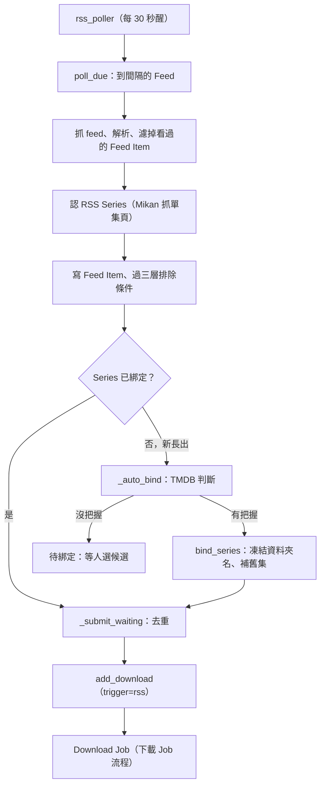

# RSS Feed 與 RSS Series（Feed / RSS Series）

## 用途

管理員貼上 Mikan、Nyaa 或 acg.rip 的 RSS 網址（Feed），Berth 定時去讀，把每一筆新發佈（Feed Item）認出是哪部作品、哪個字幕組，綁到作品與 Library Route 後自動送進 qBittorrent，之後的流程與手動下載相同。使用者看到的是 `/rss` 頁（以作品分組）、作品頁的「訂閱」，以及助理的 `rss.subscribe`。

## 怎麼運作

**RSS Series 是 Berth 對「某個番組 × 某個字幕組」的記憶，由 Feed Item 自動長出來，不是使用者建的規則。** 它記著綁到哪部作品、哪條 Route、季號與 offset（字幕組集號與 TMDB 集號的差）、是否已確認第一批（`berth/models/rss.py`）。ADR-0007 的取捨是「全部接受、只排除」：不做字幕組白名單，同一集兩個字幕組都要。

一輪輪詢（`berth/services/rss.py` 的 `_poll_round`）依序做：

1. 抓 feed、解析，用 `(feed_id, guid)` 濾掉看過的。
2. 認 RSS Series 的鍵。Mikan 要多抓一次單集頁取（番組 id, 字幕組 id）；Nyaa / acg.rip 用標題骨幹加字幕組（`_series_key`）。認不出的那筆**不寫**，下一輪再試。
3. 寫 Feed Item，同時過三層排除條件（全域、Feed、RSS Series 取聯集，預設排合集）。狀態是 `excluded`、`unbound`（Series 還沒綁）或 `matched`（`_record`、`_arriving`）。
4. 新長出的 Series 當輪就去 TMDB 認作品（`_auto_bind`）：標題相等、開播日對得上、只有一部才自動綁，否則進「待綁定」並列候選。只在長出那輪認；暫時查不到（逾時、5xx）才在 1、4、12 小時後重認（`LOOKUP_RETRIES`）。
5. 綁定（`bind_series`）時 Mikan 讀單一 feed 補齊整季舊集，一律補、沒有開關；之後每天補漏一次（`_backfill_due`）。
6. 送單（`_submit_waiting`）：先去重（同 info hash、帳本已有同版本；v2 不算重複），再呼叫 `add_download`，trigger 為 `rss`，actor 為 `rss:<id>`。

搜尋類 Feed（Nyaa、acg.rip）第一輪帶著幾個月歷史，所以 `primed_at` 空著時一筆都不送，停在預覽等管理員選「全部下載」或「只追之後的」（`preview_feed`、`prime_feed`）。Mikan 聚合 feed 只有最近幾集，加入時就算選過。

綁定是第一次通向磁碟的時刻：資料夾名在那一刻凍結（`freeze`），所以人工綁定要明確按一次確認。

## 流程圖

`rss_poller` 每 30 秒醒一次，只處理到了自己間隔（預設 15 分鐘）的 Feed。新 Item 認出 RSS Series 後，已綁定的直接去重、送單；新長出的先走 `_auto_bind`，有把握就綁並補舊集再送，沒把握停在待綁定、Item 留著不送。人在 `/rss` 選候選後走同一支 `bind_series`。

## 涉及的模組

- `berth/services/rss.py`（3347 行，Feed、Series、輪詢、綁定、訂閱都在這）
- `berth/pipeline/rss.py`（只管何時醒）、`berth/adapters/rss/`（mikan、nyaa、acgrip、feed 解析，各有 Fake）
- `berth/parser/binding.py`（`judge`，有沒有把握）、`berth/parser/exclusion.py`（排除規則）
- `berth/models/rss.py`；前端 `web/src/rss/`、`web/src/pages/RssPage.tsx`
- 以作品訂閱：`rss.subscribe`（`berth/services/rss.py`）與 `berth/services/bangumi.py` 的 `match_bangumi`

## 相關決定

- [ADR-0007](../../adr/0007-rss-series-model.md)：RSS 以 RSS Series 為單位，全部接受只排除，綁定時一律補舊集，Feed 必選 Route。
- [ADR-0014](../../adr/0014-no-site-request-budget.md)：不做站點請求預算，站回 429/5xx 靠既有退路。
- [brief §15](../../design-brief.md)：綁定、補舊集、第一輪預覽的規則全文。

## 限制

- **以作品訂閱可能挑錯季**：同一個 TMDB 條目、Mikan 每季一頁時，會用作品首播日挑到第一季，實測補送 100 與 39 筆舊集（brief §20.29）。0.5.1 已發出，修正是 M6 票 01，尚未做（`.scratch/m6/spec.md`）。
- 自動綁定只在長出那輪做一次，壞掉的番組頁因此不會被反覆打，但人拆掉的綁定也不會被綁回去。
- 放寬排除規則不會把已擋下的放回來，只有收緊會重看還沒送的（`_rescreen`）。
- `rss.py` 單檔過大，改動容易波及訂閱、綁定、補舊集（推斷，依行數）。
- 其他已知小項見 plan §11.9。

## 細節在哪

`berth/services/rss.py` 開頭的 docstring 把整套規則講完了；`brief §15`、`plan §3.2`（rss_poller）與 `§8.5`；名詞見 `CONTEXT.md` 的 Feed、RSS Series、補舊集。第一批確認見 [first-batch.md](first-batch.md)。
