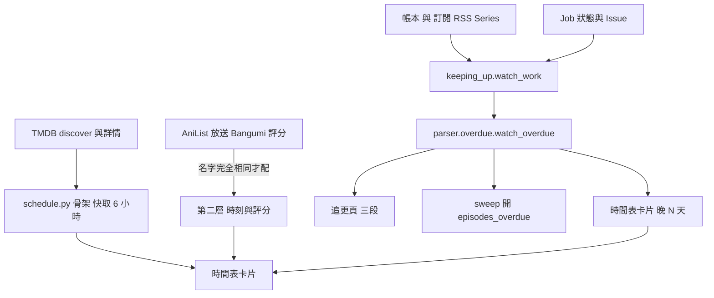

# 時間表與追更（Schedule、Keeping up、Overdue）

## 用途

**時間表**（`/schedule`，每個人都看得到）是這一週 TMDB 上播的動畫，一集一張卡，放在播出那一天，卡上標已入庫、已訂閱、「晚 N 天」，對得上時還有放送時刻和 Bangumi 評分。**追更**（`/schedule/tracking`，只有管理員）回答另一個問題：已訂閱的作品有沒有按時入庫，分「要你動手」「準時」「斷更很久」三段（`brief §13`、`CONTEXT.md`）。

## 怎麼運作

**時間表的骨架來自 TMDB，狀態每次現算。** `discover/tv` 列出這一週有集播出的動畫（限動畫類型、原文語言日文與中文），但每筆沒有集和播出日，所以每部再讀一次詳情的上一集與下一集，落在這週（前後各放寬一天，因為深夜檔常差一天）的才進時間表。骨架快取在程序內 6 小時；已入庫、已訂閱、晚了這些是本地事實，每次打開都照資料庫算，訂閱完馬上要變（`berth/services/schedule.py:193`、`263`）。

**放送時刻與評分是第二層，對不上就不顯示，不猜。** AniList 給未來的放送時刻，Bangumi 給評分；兩邊都沒有 TMDB id，所以要原文名壓平後完全相同才算同一部，時刻另外要日期差一天以內。任一來源失敗或超過 10 秒就只少那一格，並暫停 5 分鐘不再問（`berth/services/schedule.py:237`、`248`）。

**「晚了」是同一套判定，三個地方共用。** 一部作品的遲到判定（`parser.overdue.watch_overdue`，純函式）：以最後入庫的一集為基準，基準之後播出的集，從播出日隔天 00:00 起算滿門檻（預設 2 天，可在訂閱頁改）還沒入庫就是晚。下載還在動（停滯不算）、等審核、已有 Issue 管著的集不算晚；其餘不管卡在字幕組沒發、送單失敗、停滯或入庫失敗，都算（`berth/parser/overdue.py:105`）。巡檢據此開 `episodes_overdue` Issue，追更頁分段，時間表卡片顯示「晚 N 天」，所以三處看到的是同一批作品。

**判定有兩個刻意的例外。** 基準那一集與下一集播出日相隔超過 21 天，多半是下一個 cour（Mikan 上是另一個番組），理由標「換輪」而非字幕組遲到；最後一集缺集播出滿 60 天就不再提醒，收進「斷更很久」（`berth/parser/overdue.py:41`、`44`）。

**追更頁一部作品一列，狀態是 Why Not 的結論。** 它取基準之後已播、沒入庫的集，用[探索與作品詳情](discover-and-media.md)裡的 `conclude` 算出整部的結論；「晚 N 天」是最早那一集晚的集從播出日到今天的天數，不是從過門檻那天算。分段：有晚的集，或卡在入庫失敗、下載沒成、等審核、待綁定、停滯，是「要你動手」（`berth/services/keeping_up.py:119`、`52`）。這一頁只讀資料庫，不問 TMDB；快照由每日巡檢前的刷新更新。

TMDB 提供時間表的骨架，AniList 和 Bangumi 補上時刻與評分。訂閱與帳本、Job 與 Issue 一起進 `watch_work`，交給純函式 `watch_overdue` 判定。同一個判定結果分三路：追更頁分段、巡檢開 Issue、時間表卡片的「晚 N 天」。

## 涉及的模組

- `berth/services/schedule.py`、`keeping_up.py`；`berth/parser/overdue.py`、`parser/airing.py`（播出日比對，屬解析器）。
- `berth/adapters/anilist/`、`adapters/bgm/`；`berth/services/sweep.py`（每日開 Issue）。
- `berth/services/anilist.py`、`bgm.py` 是給 AI 助理「新番推薦」用的當季清單，不是時間表本身。
- 前端 `web/src/schedule/`、`web/src/tracking/`。

## 相關決定

- [設計簡報 §13](../../design-brief.md)：時間表與追更頁的內容與角色（時間表每個人、追更只有管理員）。
- [設計簡報 §20.3](../../design-brief.md)：AniList 和 Bangumi 沒有 TMDB id，只能比原文名。
- [ADR-0015](../../adr/0015-notifications-discord-dm.md)：不另做其他通知管道，所以沒接 Discord 的管理員只在追更頁看到遲到。
- 全部列不篩（含長壽與兒童節目）、晚 N 天從播出日算：使用者 2026-11-04 定（`berth/services/schedule.py:1`、`keeping_up.py:20`）。

## 限制

- 訂閱的作品才會被判晚；沒有 TMDB 快照的作品說不出哪集播了，直接歸「準時」。
- 刪掉 Feed 就不再算訂閱，也就不再有遲到。
- TMDB 只有日期，沒有時刻，所以「晚」以日界線算，不是小時。

## 細節在哪

`plan §6`（schedule 端點群）、`§7`、`§3.2`（sweeper）；`CONTEXT.md`〈時間表〉〈Overdue〉〈Keeping up〉〈Next run〉；`docs/archive/m5.5.md`。
