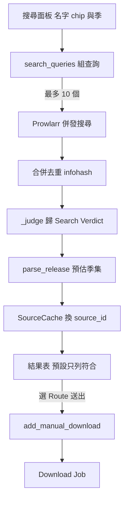

# 作品搜尋與送單（Search Result、Search Verdict、Search Name、Missing Episode Search）

## 用途

在作品詳情頁按搜尋，Berth 問 Prowlarr（一個統一的索引站管理員）全部啟用中的索引站，把找到的 torrent 列成表，每筆附解析出的季集預估和「符不符合這部作品」的分類。使用者自己挑一筆、選 Route（入庫目的地）按送出，就變成一筆 [Download Job](download-job.md)。季表上還有「搜這部作品缺的集」，由 Berth 依缺的季集產生查詢（`brief §13`）。

## 怎麼運作

**一部作品有好幾個名字，所以一次搜尋發很多個查詢，同時進行。** 名字是一顆顆 chip（英文名、原名、中文名、簡體中文名、別名），由人開關，種類的開關全域記住；季是「不指定季」加逐季。查詢是「開了的名字 × 開了的季」。併發是因為 Prowlarr 要現場去連各追蹤站，單一查詢實測 60 至 85 秒，三個併發共 35 秒（`berth/services/search.py:1`、`berth/services/search_queries.py:94`）。

**查詢數有硬上限 10 個，超過就整次不問，不砍尾巴。** 名字與季是使用者自己開的，默默少問幾個等於替他做決定（`MAX_QUERIES`，`berth/services/search_queries.py:25`）。

**缺集搜尋的記號由「缺的形狀」決定。** 整季缺用季記號（只有一季的番不接記號，因為發佈名不寫「第1季」）；缺幾集就一集一個記號，有絕對編號用絕對編號，否則 `S03E05`。逐集放不下就收成季記號，再放不下就分批，下一批由人按（`berth/services/search_queries.py:136`）。

**結果合併去重後，每一筆歸到一類（Search Verdict），畫面預設只列「符合」。** 去重鍵是 info hash（Mikan 用十六進位、dmhy 用 base32，會先正規化）。分類是排了先後的粗篩，證據硬的先：名字完全對不上、索引站分在成人類、不是電影（讀到季集記號）或年份不符、只對上部分名字（可能是衍生作品），都不中才是「符合」。對不上的也照 Sonarr 互動搜尋的慣例送出，讓使用者自己判斷（`berth/services/search.py:558`）。自己打關鍵字時只分「對得上」「對不上」。

**解析器只跑在送到畫面的那幾百筆上。** 粗篩用純字串比對，因為 `parse_release` 每筆約 14 毫秒，一兩千筆全解析會卡住事件迴圈半分鐘；每類各自逐站輪流取（符合取 100，其餘每類 50），避免某個站的熱門清單佔滿結果。

**下載連結不出伺服器。** Prowlarr 的連結帶 API key，所以每筆結果存進程序內的 `SourceCache` 兩小時，畫面只拿一個隨機的 `source_id`；送單只收這個 id，因此也送不進任意網址。重啟或過期就是「再搜一次」（`berth/services/sources.py:30`）。

選好名字與季後，`search_queries` 組出查詢並交給 Prowlarr 併發搜尋。結果去重、歸類、解析預估之後，連結換成 `source_id` 送給畫面。使用者挑一筆並選 Route，`add_manual_download` 用 `source_id` 換回連結，建出 Job，並通知其他訂閱了「正在下載」的人。

## 涉及的模組

- `berth/services/search.py`：搜尋、分類、取用上限；`search_queries.py`：名字與缺集的查詢；`sources.py`：`SourceCache`。
- `berth/services/downloading.py`（`add_manual_download`）、`jobs.py`（`add_download`）；`berth/api/search.py`、`api/jobs.py`。
- `berth/parser/`（`mentions`、`misfit`、`partial_title`、`season_tokens`）；`berth/adapters/prowlarr/`、`adapters/indexer/`。
- 前端 `web/src/media/`（`SearchPanel.tsx`、`QueryChoices.tsx`、`SearchResults.tsx`）。

## 相關決定

- [ADR-0001](../../adr/0001-indexer-manager-prowlarr-only.md)：索引站只經 Prowlarr，不做 Jackett 或通用 Torznab。
- [plan §8.4](../../plan.md)：查詢怎麼組、結果怎麼分類與取用、逾時多長。
- [設計簡報 §20.16 至 §20.21、§20.28](../../design-brief.md)：年份與類型篩法、Prowlarr 行為、單季番不接季記號的實測。
- 查詢數上限 10 是使用者在 2026-10-13 拍板（`berth/services/search_queries.py:25`）。

## 限制

- 分類只看發佈名與索引站分類碼，會誤判；所以每類都送，不丟掉。
- 公開索引站常有幾個連不上，這是常態：失敗的查詢只變一條紅色纜繩，其餘照常（`berth/services/search.py:619`）。
- `SourceCache` 不落地，Berth 重啟後所有結果表都要重搜。
- 分類碼不拿來查詢（各站映射自訂），Berth 沒有自己的站點請求預算，節流是 Prowlarr 的事（[ADR-0014](../../adr/0014-no-site-request-budget.md)）。

## 細節在哪

`plan §8.4`、`§6`（search 端點群）；`brief §13`、`§20.19 至 §20.21`；`CONTEXT.md`〈Search Result〉〈Search Verdict〉〈Search Name〉〈Missing Episode Search〉。
