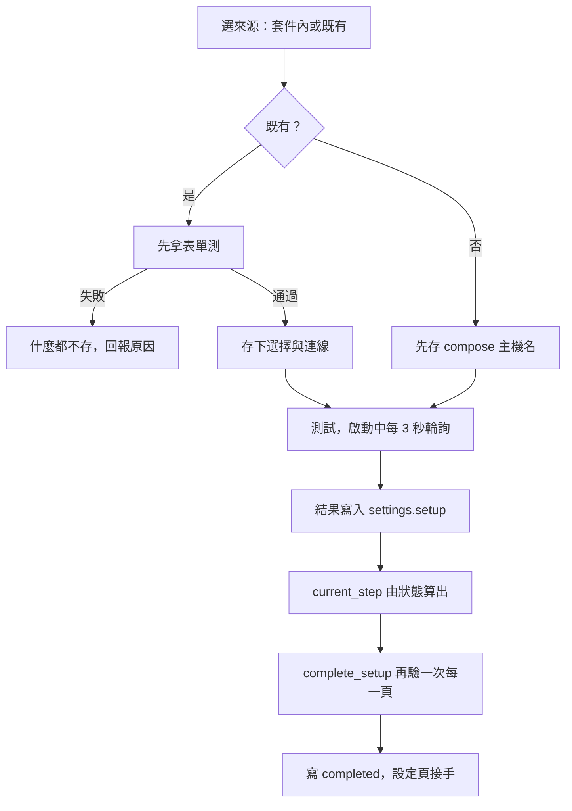

# 設定精靈（Berth）

## 用途

第一次打開 Berth 時，精靈帶你把三個外部服務（Service）和 TMDB 接起來：Jellyfin、qBittorrent、Prowlarr，加上媒體庫路徑。每個服務由你選「套件內」（`bundled`，compose 一起起的那一台）或「既有」（`existing`，你自己的那一台）。畫面上一格一頁，叫 Berth（泊位）。跑完之後同一批元件變成「設定」頁，之後改設定都在那裡（`plan §9.3`、ADR-0010）。

## 怎麼運作

**來源由你選，Berth 不偵測。** 選之前 Berth 不對那個服務發任何請求。選完當場測一次，結果存在 `settings.setup.choices`（`berth/services/setup.py` 的 `choose_service`）。早期版本是偵測，使用者試跑後 2026-09-29 推翻（ADR-0010）。

**頁序（六頁，最後是完成頁）。** 1 Jellyfin、2 qBittorrent、3 媒體庫與路徑、4 Prowlarr 與索引站、5 TMDB、6 完成（`setup.py` 的 `STEP_*`）。目前在第幾頁不是存起來的游標，而是每次從各頁的狀態算出來（`_current_step`）：頁 1 看擁有者成立沒有，頁 2 看 qBittorrent 測試是綠的，頁 3 看 Route 都通過檢查，依此類推。這樣你換了一台服務，頁碼不會說謊。

**頁 1 的 Jellyfin 管理員就是 Berth 的擁有者。** Berth 沒有自己的帳號。套件內的 Jellyfin 由 Berth 建管理員並跑完它的初始設定；既有的就用它的管理員登入。成功後 Berth 換一把名叫「Berth」的 API key，並發 session（`claim_owner`、`claim_jellyfin`）。誰先到誰建立，之後擁有者鎖在同一台 Jellyfin：位址只能換成同一個 ServerId 的伺服器（ADR-0012）。

**「只管 Berth 自己的東西」。** 接管既有服務時，Berth 只建立並管理自己擁有的物件：API key「Berth」、`berth-*` 分類、媒體庫上加的 Berth 路徑、你勾選加入的索引站。帳密和全域偏好一律不碰（ADR-0013）。

**既有服務先測、測過才存。** 測不過什麼都不存，原本能用的那台照舊用（`choose_service` 的 docstring）。套件內的相反：先存再測，因為容器可能還在啟動，要靠存下的選擇輪詢，最長 2 分鐘（`TEST_WINDOW`）。

**步驟狀態（Step status）有五種**：`ok`、`skipped`、`running`、`failed`、`pending`。`skipped` 的意思是「已經是這樣」，不是「跳過不做」。重按精靈時大部分步驟都會是它。

流程從選來源開始。既有的服務先用表單測，失敗就整個放棄；套件內的先存位址再測。兩條路都把結果寫進 `settings.setup`，下一頁是什麼由這份狀態算出來。按「完成」時 `complete_setup` 會把每一頁再驗一次，因為你可能回頭弄壞了某一頁，通過才寫下 `completed`。

## 涉及的模組

- `berth/services/setup.py`：頁序、擁有者、選來源與測試、完成。
- `berth/services/jellyfin.py`、`qbittorrent.py`、`indexer.py`、`tmdb.py`：各頁的命令（Jellyfin 自動初始化序列見 `plan §9.4`）。
- `berth/services/steps.py`：步驟狀態與失敗代碼；`clients.py`：套件內主機名與 client 工廠；`leftovers.py`：換一台服務時列出 Berth 在舊那台建的東西。
- `berth/services/routes.py`：頁 3 的 Route 與檢查，見 [Library Route](library-route.md)。
- 前端：`web/src/setup/`、`web/src/settings/`（共用元件）、`web/src/pages/SetupPage.tsx`。

## 相關決定

- [ADR-0010](../../adr/0010-wizard-manual-service-selection.md)：逐服務手動選套件內或既有，不偵測；精靈只管第一次，之後在設定頁。
- [ADR-0011](../../adr/0011-wizard-accepted-frictions.md)：TMDB 憑證是精靈的閘門；建管理員的密碼只有一格。
- [ADR-0012](../../adr/0012-owner-is-jellyfin-admin.md)：擁有者就是 Jellyfin 管理員，鎖在同一台 Jellyfin。
- [ADR-0013](../../adr/0013-berth-manages-only-its-own-objects.md)：只建立與管理 Berth 擁有的物件。
- [設計簡報 §16.3–16.4](../../design-brief.md)：服務來源與既有服務接入的規則。

## 限制

- 既有的 Jellyfin 和 qBittorrent 必須和 Berth 在同一台主機，並把同一個宿主目錄掛在 `/data`。不做 remote path mapping（`plan §9.5`）。
- 版本下限：Jellyfin 12.0、qBittorrent 4.4、Prowlarr 1.3.2，測試時就擋（`plan §9.3`）。
- TMDB 被防火牆擋住就裝不完（ADR-0011 接受的代價）。
- 一套服務只配一個 Berth；兩個 Berth 接同一台會共用 `berth-*` 分類和 API key（ADR-0013）。
- 擁有者成立後換不了 Jellyfin 的來源；換媒體伺服器等於重裝（ADR-0012）。

## 細節在哪

`plan §9.3`（流程與錯誤分層）、`plan §9.4`（Jellyfin 初始化序列）、`plan §9.5`（既有服務接入）、`docs/guide/setup-wizard.md`、`docs/guide/existing-services.md`。
