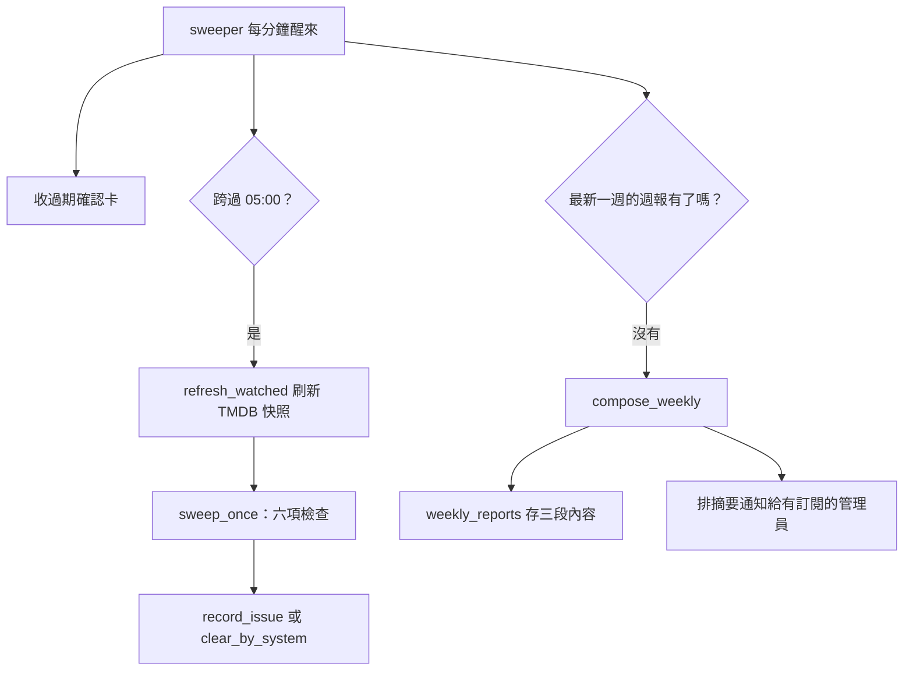

# 巡檢與週報（Sweep / Weekly Report）

## 用途

巡檢（Sweep）每天 05:00 跑一輪不花 token 的程式檢查，找出「該來卻沒來」的事：第一批卡住、Feed 一直失敗、已入庫集數中間缺了、同一集意外多份、訂閱的作品遲到。要人動手的寫成 Issue。週報（Weekly Report）每週一份回顧：這週入庫了什麼、修了什麼、還有什麼等人。管理員有訂閱的話，Discord 會收到一則摘要。

## 怎麼運作

**巡檢六項，一起 commit**（`berth/services/sweep.py` 的 `sweep_once`）：

- 第一批卡住（`first_batch_stuck`）：還沒確認的 RSS Series 有 Job 停在 `submit_failed` 或 `client_error` 超過 24 小時。
- Feed 一直失敗：輪詢或每日補漏從由好轉壞起超過 24 小時，各開一件。
- RSS Series 缺集（`series_episodes_missing`）：已入庫集數有洞，洞之後的集入庫滿 7 天才算。
- 同一集意外多份（`series_episodes_collide`）：版本並存（別組、v2、簡繁）不算。
- 遲到（`episodes_overdue`）：訂閱的作品，最後入庫那集之後有集播出滿門檻（預設 2 天）還沒入庫；判定在 `parser/overdue.py`。一部作品一件。
- 放太久：「等你處理」最舊一件等滿 3 天，提醒有訂閱的管理員，同一件 3 天內只提醒一次。

已有 Issue 管著的不重複開；條件消失由系統收掉（`resolved_by = system`）。

**排程照對帳的形狀。** `sweeper` 每分鐘醒一次，跨過 05:00 才跑；重啟不立刻跑、錯過的不補跑，因為巡檢看的是現況。05:00 比對帳的 04:00 晚一小時，這樣巡檢看到的是對帳寫完的 Issue（`berth/pipeline/sweeping.py`）。巡檢前會先刷新訂閱作品的 TMDB 快照，刷新失敗的作品這一輪不開也不收（`refresh_watched`）。

**週報是存下來的。** 一週是週一 05:00 到下一個週一 05:00（容器時區），週一巡檢後接著產生（`weekly.py` 的 `week_ending`、`compose_weekly`）。內容三段：入庫（依作品的季集範圍）、修了（核准、rematch、人解決與系統收掉的 Issue 各幾件）、等人（產生那一刻的三份清單）。存結果而不是每次重算，因為 purge 會連帳本和事件一起刪，舊週報不該跟著變。同一週只有一份，重啟後會補上漏掉的那一週，只有新裝、還沒有任何週報時不補。

**同一個迴圈也收過期的確認卡**（`proposals.expire_due`），每次醒來都收，不等 05:00。

每次醒來先收過期確認卡。跨過 05:00 就先刷新快照、再跑六項檢查，結果寫成 Issue 或由系統收掉。另一條獨立的路徑檢查最新一週的週報有沒有，沒有就產生並存下三段內容，同時排一則摘要通知。巡檢壞了不擋週報，因為週報的「等人」讀的是清單，不是巡檢結果。

## 涉及的模組

- `berth/pipeline/sweeping.py`：排程、週報觸發、確認卡過期。
- `berth/services/sweep.py`：六項檢查與提醒；`berth/services/weekly.py`：週報內容與摘要。
- `berth/parser/overdue.py`：遲到判定；`berth/services/waiting.py`：「等你處理」清單。
- 前端：`web/src/weekly/`、`web/src/pages/WeeklyPage.tsx`（只有 admin，入口在帳號選單）。

## 相關決定

- `plan §3.2`〈sweeper〉、`plan §11.5`〈巡檢〉：每日 05:00、與對帳錯開、週報補跑規則。
- [設計簡報 §9.1](../../design-brief.md)：巡檢五種 Issue 與 `episodes_overdue` 的判定，以及「忽略在條件持續期間有效」。
- [ADR-0008](../../adr/0008-ai-autonomy-and-optional-ai.md)：沒有 AI 也完整可用；M5 起巡檢標出的項目可交給 AI 任務（M6.5 計劃）。

## 限制

- 時間都是容器的 `TZ`，compose 範本預設 `Etc/UTC`，不改的話 05:00 是 UTC 的 05:00（`pipeline/reconciling.py`）。
- 週報頁沒有「現在產生一份」的端點，只能等排程（`plan` §6 weekly）。
- 遲到最後一集缺集滿 60 天不再提醒；基準之前的洞算「缺集」，不算遲到（`CONTEXT.md`「Overdue」）。
- 放太久的起算時間來自送出迴圈第一次看到那件的時刻，不是 Issue 的偵測時間（`sweep.py` 檔頭）。

## 細節在哪

`plan §3.2`、`plan §11.5`、`design-brief.md` §14〈巡檢〉與 §9.1、`CONTEXT.md`「Sweep」「Weekly Report」「Overdue」。
